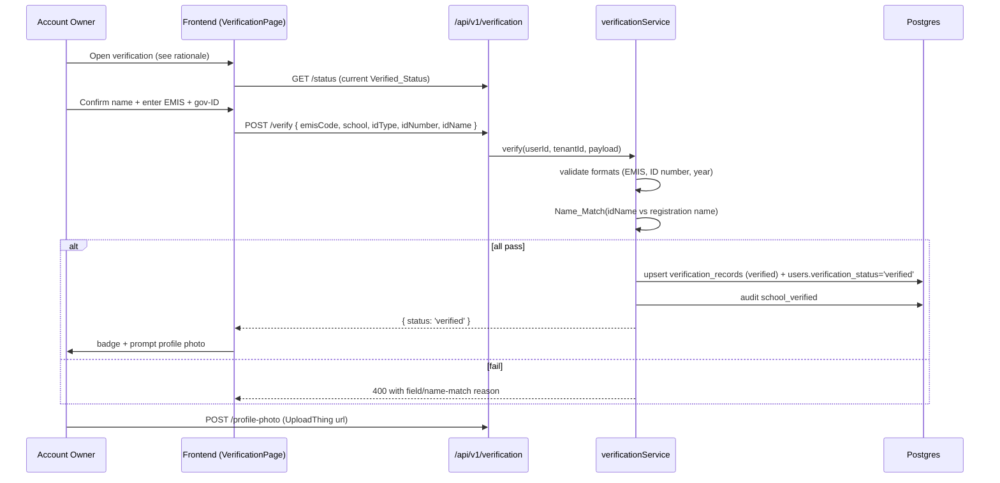

# Design Document — Account Owner Verification (Simple Instant)

## Overview

The account owner verifies their school by entering the **EMIS code** and their **government-ID
details** (type, number, name-as-printed). WiSkul validates each field's **format** (sensible
ranges, not rigid), confirms the ID **name matches** the registration name, and — when both pass —
**verifies the tenant instantly**: a Verified School badge appears, the owner is prompted for a
profile photo, and gated high-impact features unlock. No uploads, no admin review, no vendor.

A pluggable slot is left for a stronger confirmation tier later (EMIS lookup / super-admin
spot-check) without changing this flow. WiSkul stores only entered identifiers, the name-match
result, status, and the profile photo.

## Architecture



## Components and Interfaces

### Backend: `verificationService.ts`

```ts
type IdType = 'national_id' | 'passport' | 'drivers_license';

interface VerifyInput {
  legalName: string;               // confirmed at verification (pre-filled from registration)
  emisCode: string;
  idType: IdType;
  idNumber: string;
  idName: string;                  // name as printed on the ID
  schoolLevel?: string;
  district?: string;
  yearEstablished?: number;
}

class VerificationService {
  getStatus(userId, tenantId): Promise<{ status: 'unverified'|'verified'; verifiedAt?: string; lastReason?: string }>;
  verify(userId, tenantId, input: VerifyInput): Promise<{ status: 'verified' }>;  // throws AppError on invalid
  setProfilePhoto(userId, tenantId, url: string): Promise<void>;

  // Pluggable future tier (no-op now): returns null = "not confirmed by external source".
  // A later EMIS-lookup provider implements this behind an interface.
  // confirmExternally(emisCode): Promise<boolean | null>;
}
```

Validation (Req 3) and Name_Match (Req 4) live here:
- **EMIS**: `^[A-Za-z0-9]{4,20}$` after trim.
- **ID number** per type: passport `^[A-Za-z0-9]{6,12}$`; national_id / drivers_license
  `^[A-Za-z0-9-]{5,20}$`. Reject empty/whitespace/wrong-char.
- **Year**: 4-digit, 1900..currentYear when provided.
- **Name_Match**: normalize (lowercase, strip accents/punctuation, collapse whitespace), compare
  token sets so order + middle names are tolerated; require all registration-name tokens present
  in the ID name (or vice-versa) → match.

### Backend routes (`/api/v1/verification`)

```
GET    /verification/status         (auth, owner)  → { status, verifiedAt?, lastReason? }
POST   /verification/verify         (auth, owner)  → { status: 'verified' } | 400 reason
POST   /verification/profile-photo  (auth, owner)  → { ok: true }
```

### Feature gating (Req 6)

- `requireVerifiedSchool` middleware: 403 `SCHOOL_VERIFICATION_REQUIRED` when the tenant owner's
  `verification_status !== 'verified'`.
- Applied to the default Gated_Features (adjustable): billing/subscription changes,
  inviting/creating staff, issuing/printing ID cards, bulk data export, bulk delete. Day-to-day
  features unaffected (Req 6.5). Backend is the source of truth (Req 6.4).

### Frontend

- `VerificationPage`: rationale panel → confirm name + EMIS + gov-ID form (inline validation
  mirroring backend rules) → instant result → profile-photo step.
- `VerifiedBadge` component on the owner/tenant profile; unverified dashboard CTA; gated buttons
  show "Verify your school to unlock".
- `verificationService` (frontend) API calls.

## Data Models

### Migration `125_school_verification.ts`

```ts
// users: verification state on the owner (nullable; only the owner uses it)
alter users add:
  verification_status  varchar(20) not null default 'unverified'  // unverified | verified
  verified_at          timestamp null
  profile_photo_url    text null

// verification_records — one row per tenant (latest), tenant-isolated
id uuid pk default gen_random_uuid()
user_id uuid fk users
tenant_id uuid not null
emis_code varchar(20) not null
school_level varchar(40) null
district varchar(80) null
year_established integer null
id_type varchar(20) not null
id_number varchar(40) not null
id_name varchar(160) not null
name_match boolean not null
status varchar(20) not null          // unverified | verified
last_reason text null
created_at, updated_at
index (tenant_id)
```

No biometric data; no uploaded files (Req 8.4).

## Error Handling

`AppError(message, status, code)`:

| Condition | Status | Code |
| --- | --- | --- |
| Non-owner submits | 403 | `NOT_ACCOUNT_OWNER` |
| EMIS/ID/year format invalid | 400 | `VERIFICATION_FIELD_INVALID` |
| Name mismatch | 400 | `IDENTITY_NAME_MISMATCH` |
| Gated feature while unverified | 403 | `SCHOOL_VERIFICATION_REQUIRED` |

## Correctness Properties

### Property 1: Verify requires format + name match
Verified_Status becomes `verified` only when every field passes format validation AND the Name_Match succeeds.
**Validates: Requirements 5.1, 5.2**

### Property 2: Format bounds are ranges, not rigid
Valid inputs across the accepted length ranges are accepted; empty/whitespace/wrong-character/out-of-range inputs are rejected.
**Validates: Requirements 3.3, 3.4, 3.5, 3.6**

### Property 3: Name normalization tolerance
Name matching succeeds across case, accents, extra whitespace, name-order, and middle-name variations, and fails on genuinely different names.
**Validates: Requirements 4.2, 4.3**

### Property 4: Backend gating
Every gated feature is denied server-side while the tenant is unverified, regardless of UI state.
**Validates: Requirements 6.1, 6.4**

### Property 5: Tenant isolation
All verification records and status reads/writes are scoped to the owning tenant.
**Validates: Requirements 8.2**

### Property 6: No biometric / file storage
WiSkul persists only entered identifiers, name-match result, status, and profile photo.
**Validates: Requirements 8.4**

## Testing Strategy

- Unit: format validators (EMIS, per-ID-type ID number, year ranges — accept valid, reject
  invalid); name-match normalization (order/middle-name/accents pass; different names fail);
  gating middleware.
- Integration: `POST /verify` happy path → verified + gating unlocked; mismatch/invalid → 400 and
  still unverified; gated route 403 when unverified, passes when verified.

## Security & Privacy Considerations

- Owner-only submission; tenant-scoped records; audit verify/fail events.
- Store only entered identifiers + name-match + status + photo — no biometrics, no files.
- Honest limitation documented: instant verification proves format + name-match, not registry
  existence; stronger tier is pluggable for later.
