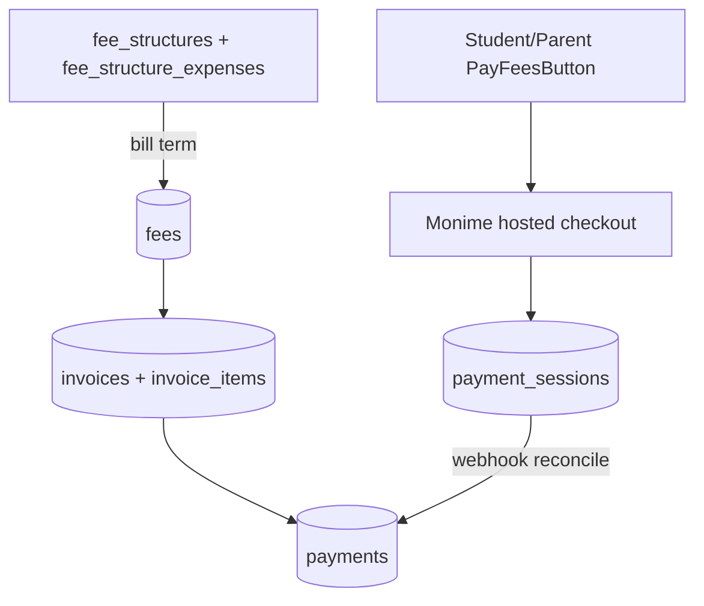
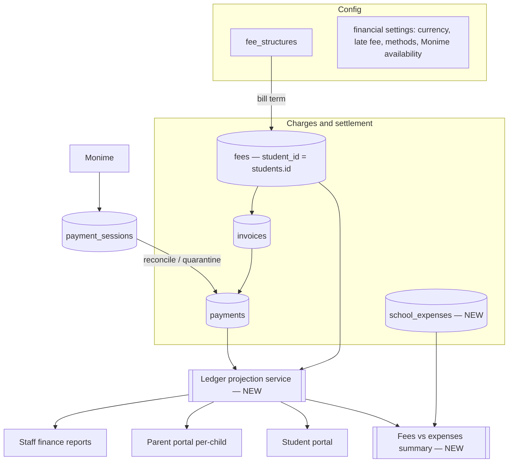
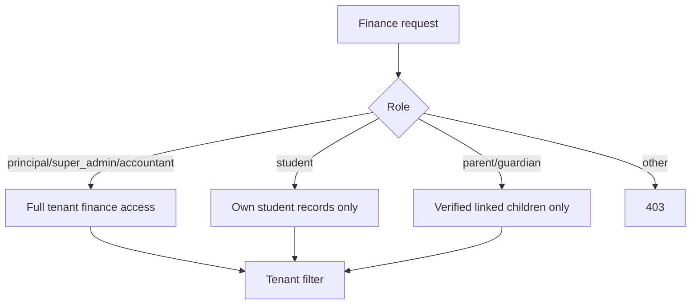

# Design Document

## Overview

This design consolidates the fragmented financial code into one coherent,
tenant-scoped financial system while preserving everything that already works
(Monime checkout, existing finance pages, student/parent fee views).

The design is deliberately **incremental and additive**: it does not rewrite the
live runtime path (`fee_structures → bill term → fees → invoices → payments`,
plus Monime reconciliation). Instead it:

1. Establishes `students.id` as the single canonical charge subject and fixes the
   one place (`feeService.createFee`) that uses `users.id`.
2. Adds a **read-only ledger layer** that projects the existing `fees` and
   `payments` rows into a per-student, per-year, per-term view used identically
   by staff reports and family portals (so the numbers always agree).
3. Adds a new **school expenses** module (table + service + routes + UI).
4. Extends **financial settings** with role restriction, accepted payment
   methods, and Monime availability configuration (secrets never returned to the
   browser).
5. Hardens the **Monime webhook** to quarantine unmatched events.
6. Enforces **finance-staff authorization** consistently across all finance
   endpoints (today it is applied unevenly).
7. Retires dead code paths (generic gateway service, in-memory fee config) from
   the active surface without deleting historical data.

Requirements traceability is given per component in the sections below.

## Architecture

### Current state (retained)



### Target state (added layers in bold)



### Multi-tenancy

Every table in the domain is tenant-scoped, either by a direct `tenant_id`
column (`fees`, `payments`, `invoices`, `fee_structures`, `payment_sessions`,
`school_expenses`) or, for child tables, via a join to a tenant-scoped parent
(`fee_structure_expenses` → `fee_structures`, `invoice_items` → `invoices`).

All finance services accept and require a `tenantId` and filter every query by
it. A shared guard resolves the acting user's tenant from the auth context; no
finance endpoint trusts a tenant id from the request body. (Req 1.1–1.3)

## Components and Interfaces

### 1. Canonical student identity fix

**Problem:** `feeService.createFee` and `getOverdueFees` join `users` and treat
`student_id` as a `users.id` with `role = 'student'`, while `fee_structures`
billing and the Monime reconcile path use `students.id`. Mixed identifiers break
the ledger and duplicate-detection.

**Decision:** `fees.student_id`, `payments.student_id`, `invoices.student_id`,
and `payment_sessions.student_id` all reference **`students.id`**. This matches
the majority of the codebase (billing, dashboards, Monime, backups).

**Changes:**
- `feeService.createFee` / `getOverdueFees` / any `users`-based student join are
  changed to resolve and validate against `students.id` within the tenant.
- A guard `assertStudentInTenant(studentId, tenantId)` (already present in
  `slReportCardService`) is reused/shared. If a caller passes an id that resolves
  to a `users` row but not a `students` row, the operation is **rejected** with a
  clear error rather than auto-reconciled. (Req 10.4)
- A one-time reconciliation migration scans `fees`/`payments` for `student_id`
  values that match a `users.id` (role student) instead of `students.id`, and
  rewrites them to the linked `students.id` where an unambiguous mapping exists;
  ambiguous rows are logged for manual review and left untouched (never deleted).
  (Req 10.5)

### 2. Ledger projection service (NEW)

A read-only service that projects existing `fees` and `payments` into the
per-student ledger. No new ledger table — it is computed from the source rows so
staff and family always see identical figures. (Req 2, Req 9.3)

```ts
// backend/src/services/financeLedgerService.ts
interface TermBucket {
  term: 'first_term' | 'second_term' | 'third_term';
  billed: number;
  paid: number;
  outstanding: number;
  charges: LedgerCharge[];   // fees in this term
}
interface YearBucket {
  academic_year: string;
  billed: number;
  paid: number;
  outstanding: number;
  terms: TermBucket[];       // always all three terms, zero-filled (Req 2.5)
}
interface StudentLedger {
  student_id: string;        // students.id
  tenant_id: string;
  years: YearBucket[];       // newest first
  totals: { billed: number; paid: number; outstanding: number };
}

class FinanceLedgerService {
  getStudentLedger(tenantId: string, studentId: string): Promise<StudentLedger>;
  // Tenant-scoped roll-ups reused by staff reports:
  getTenantSummary(tenantId: string, academicYear: string): Promise<TenantFinanceSummary>;
  getBreakdown(tenantId: string, academicYear: string, by: 'term'|'class'|'level'): Promise<Breakdown[]>;
}
```

- Balances are derived from `fees.balance` (charge outstanding) and summed
  `payments.amount`; the term/year come from `fees.term` / `fees.academic_year`.
- All three terms are always represented per year, zero-filled when empty.
  (Req 2.5)
- Because balances are read from live rows updated synchronously by the payment
  and billing paths, any read after a change reflects it immediately. (Req 9.4)

### 3. School expenses module (NEW)

**Table `school_expenses`:**

| column | type | notes |
|---|---|---|
| id | uuid PK | |
| tenant_id | uuid, not null, indexed | tenant scope (Req 7.1) |
| category | varchar(100), not null | e.g. Salaries, Utilities, Supplies |
| description | text, nullable | |
| amount | numeric(12,2), not null | > 0 |
| expense_date | date, not null | |
| academic_year | varchar(20), not null | |
| term | varchar(30), nullable | first/second/third or null (year-level) |
| recorded_by | uuid, nullable | users.id |
| created_at / updated_at | timestamptz | |

Indexes: `(tenant_id, academic_year)`, `(tenant_id, term)`.

The `amount` and `category` are required at the persistence layer regardless of
the actor, enforced by NOT NULL + a service-level validation. (Req 7.1)

**Service `schoolExpenseService`:** `create`, `list` (filter year/term/category),
`update`, `delete`, `summaryByYear`, `summaryByTerm` — all tenant-scoped.
(Req 7.1–7.3)

**Fees-vs-expenses summary:** a combined read that pairs
`financeLedgerService.getTenantSummary` (collection) with
`schoolExpenseService.summaryByYear` (spending) for a selected year. (Req 7.4)

### 4. Financial settings (extended)

Financial config is stored per tenant. The existing settings row is extended
(no schema churn where a settings JSON/columns already exist) with:

- `currency` (existing)
- `late_fee_rate` (existing)
- `accepted_payment_methods` (NEW — array, e.g. `['cash','monime','bank']`)
- `online_payments_enabled` (NEW — derived from Monime configuration)

Monime credentials remain **server-side environment configuration**
(`MONIME_ACCESS_TOKEN`, `MONIME_SPACE_ID`, `MONIME_WEBHOOK_SECRET`) and are never
returned to the browser. The settings API exposes only a boolean
`online_payments_enabled` / "configured" status and a masked hint, never the
secret values. (Req 8.3, 8.4)

### 5. Authorization model

A single `requireFinanceStaff` middleware (roles: `principal`, `super_admin`,
`accountant`) is applied to **all** finance management endpoints — fee CRUD,
invoice generation, manual payments, term billing, fee structures, expenses, and
financial settings. This closes the current gap where most `phase8FinancialRoutes`
endpoints use only `authenticate`. (Req 8.1, 8.2, 8.5)

Portal (self-service) endpoints remain accessible to students/parents but are
**scoped to their own records**:
- Student: read + pay own fees only.
- Parent: read + pay only fees of **verified linked children** (a `guardians`
  row linking `guardians.user_id = <parent user>` to the student). (Req 5.3,
  6.6, 8.6)



### 6. Fee structure class dropdown (polish)

The Fee Structures page already renders classes as a selectable grid from
`classesService.listClasses`. This design formalizes it as a labelled **dropdown
selector** that:
- Lists the tenant's classes (Req 3.1).
- Marks configured vs unconfigured classes for the selected year (Req 3.4).
- On selecting a class with an existing structure, loads it for editing; creating
  a second structure for the same (class, year) is blocked server-side until the
  existing one is removed (Req 3.3).
- Rejects classes outside the tenant server-side (Req 3.5).

### 7. Monime webhook hardening

The webhook reconcile path adds a quarantine branch: when an event cannot be
matched to a `payment_sessions` row (by `callbackState` session id or
`provider_session_id`) **and** cannot be matched to a tenant, the event is
written to a `payment_webhook_quarantine` table (raw payload, received_at,
reason) and acknowledged (HTTP 200 so Monime stops retrying) but **no payment is
applied**. Matched events behave exactly as today. (Req 1.5)

`payment_webhook_quarantine`: `id`, `provider`, `raw_payload` (jsonb),
`reason`, `resolved` (bool default false), `created_at`.

## Data Models

### New / changed tables

- **`school_expenses`** — new (see §3).
- **`payment_webhook_quarantine`** — new (see §7).
- **`financial_settings`** — extend the existing tenant settings store with
  `accepted_payment_methods` and an `online_payments_enabled` indicator (additive).
- **`fees` / `payments`** — no structural change; a data-reconciliation migration
  normalizes `student_id` to `students.id` (see §1). Existing rows are preserved.
  (Req 10.5)

### Retained tables (unchanged)

`fee_structures`, `fee_structure_expenses`, `invoices`, `invoice_items`,
`payment_sessions`, `refunds`.

### Retired from active surface (kept in DB, not deleted)

`fee_configurations` (phase15), the in-memory fee config service, and the generic
`phase19PaymentGatewayService` (+ its never-migrated tables) are removed from the
active routing/UI so there is one fee-definition path (`fee_structures`) and one
gateway (Monime). No historical rows are dropped. (Req 10.5)

## Error Handling

- **Cross-tenant access** → 403, no record data leaked. (Req 1.3)
- **Unmatched webhook** → quarantine + 200 ack, no payment applied. (Req 1.5)
- **Duplicate fee structure for (class, year)** → 409 with guidance to remove the
  existing one first. (Req 3.3)
- **Student identity inconsistency** (users.id passed where students.id expected)
  → 422/400 rejecting the operation with a clear message. (Req 10.4)
- **Online payment when unconfigured** → the portal hides the action; if the
  endpoint is still called it returns a 503-style "unavailable" without creating a
  session. (Req 6.4)
- **Non-finance user hitting a management endpoint** → 403. (Req 8.5)
- **Parent paying/reading a non-linked child** → 403. (Req 5.3, 6.6)
- All monetary writes (billing, payment reconcile) run in a transaction so a
  partial failure never leaves inconsistent balances.

## Correctness Properties

These are the executable invariants the implementation must uphold. They are
validated with property-based testing (see Testing Strategy).

### Property 1: Tenant isolation
For any two tenants A and B, no finance read performed by a user in tenant A ever
returns a row belonging to tenant B.
**Validates: Requirements 1.2, 1.3**

### Property 2: Ledger conservation
For any student and year, `Σ term.billed == year.billed`,
`year.outstanding == year.billed - year.paid`, and the student `totals` equal the
sum over years.
**Validates: Requirements 2.3, 9.3**

### Property 3: Payment monotonicity
Applying a completed payment of amount `a` to a student never increases
outstanding and reduces it by exactly `min(a, outstanding)`, leaving any excess
unapplied.
**Validates: Requirements 6.3**

### Property 4: Webhook idempotency
Reconciling the same session/event more than once records the payment and reduces
balances exactly once.
**Validates: Requirements 6.3**

### Property 5: Billing idempotency
Billing the same (class, term, year) twice never creates a duplicate tuition
charge for a student, while still adding other applicable charges exactly once.
**Validates: Requirements 4.3**

### Property 6: Summary agreement
For a given year, reported collection equals the ledger's paid total and reported
spending equals the sum of `school_expenses`.
**Validates: Requirements 7.4, 9.1**

### Property 7: Term zero-fill
Every year bucket exposes exactly three term buckets, even when a term has no
charges.
**Validates: Requirements 2.5**

### Property 8: Unmatched-webhook safety
A webhook that cannot be matched to a tenant applies no payment and is recorded in
quarantine.
**Validates: Requirements 1.5**

## Testing Strategy

Property-based and example tests focus on the invariants that make the money
correct:

**Correctness properties (PBT):** the numbered properties above are each encoded
as an executable property over randomly generated tenants, students, charges,
and payments.

**Example/integration tests:**
- Staff-only guard on every management endpoint; student/parent self-scope;
  parent blocked from non-linked child.
- Monime unconfigured → portal hides action; endpoint refuses to start a session.
- Duplicate fee-structure create → 409.
- Student-identity mismatch → rejected.
- Migration: identity reconciliation rewrites unambiguous rows, preserves
  ambiguous/existing rows.

Tests are backend-focused (Jest + supertest against a tenant-seeded test DB) with
a PBT library for the numeric invariants; frontend adds component tests for the
class dropdown states and the hidden-vs-shown pay action.
