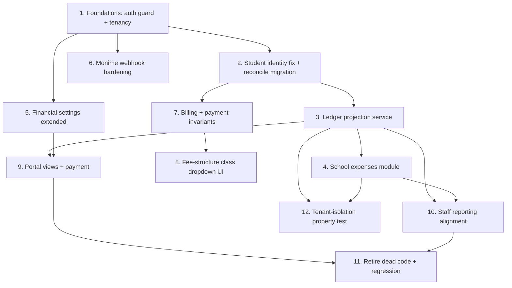

# Implementation Plan

## Overview

This plan consolidates the financial domain incrementally. It starts with shared
foundations (tenant/auth guard) and the canonical student-identity fix, then adds
the read-only ledger, the school-expenses module, extended settings, and webhook
hardening, before touching the frontend (fee-structure dropdown, portal views)
and finishing with reporting alignment, dead-code retirement, and a cross-cutting
tenant-isolation property test. Correctness properties from the design are
encoded as property-based tests within their related task groups.

## Tasks

- [x] 1. Establish shared finance foundations (tenancy + auth guard)
- [x] 1.1 Create a `requireFinanceStaff` middleware and a shared `resolveTenant`/`assertStudentInTenant` finance guard
  - Add middleware restricting to `principal`, `super_admin`, `accountant`; resolve tenant from auth context only (never request body)
  - Reuse/extract `assertStudentInTenant(studentId, tenantId)` against `students.id`
  - _Requirements: 1.1, 1.2, 1.3, 8.1, 8.2, 8.5_

- [x] 1.2 Apply `requireFinanceStaff` consistently across all finance management endpoints
  - Cover fee CRUD, invoice generation, manual payments, term billing, fee structures, expenses, financial settings in `phase8FinancialRoutes` and `feeStructureRoutes`
  - Leave portal self-service payment endpoints on `authenticate` with per-user scoping
  - _Requirements: 8.1, 8.2, 8.5, 8.6_

- [x] 1.3 Write tests for the auth guard and tenant filtering
  - Non-finance role → 403 on every management endpoint; cross-tenant read → 403 with no data
  - _Requirements: 1.3, 8.5_

- [x] 2. Canonical student identity fix
- [x] 2.1 Change `feeService.createFee` and `getOverdueFees` to resolve/validate `students.id`
  - Remove the `users` join that treats `student_id` as a user id; validate via `assertStudentInTenant`
  - Reject (422/400) when an id resolves to a user but not a student; do not auto-reconcile
  - _Requirements: 10.4_

- [x] 2.2 Write a one-time, idempotent data-reconciliation migration for `fees`/`payments`
  - Rewrite `student_id` values that match a `users.id` (role student) to the linked `students.id` where unambiguous
  - Log ambiguous rows for manual review; never delete rows
  - _Requirements: 10.4, 10.5_

- [x] 2.3 Write tests for identity resolution and the reconciliation migration
  - Unambiguous rows rewritten; ambiguous/existing rows preserved; mismatch on create rejected
  - _Requirements: 10.4, 10.5_

- [x] 3. Ledger projection service
- [x] 3.1 Implement `financeLedgerService.getStudentLedger` (per year, per term, zero-filled)
  - Project `fees` + `payments` into `StudentLedger` with billed/paid/outstanding per term and year
  - Always emit exactly three term buckets per year
  - _Requirements: 2.1, 2.2, 2.3, 2.4, 2.5_

- [x] 3.2 Implement tenant roll-ups: `getTenantSummary` and `getBreakdown` (term/class/level)
  - Reuse the same source rows as the student ledger so figures agree
  - _Requirements: 9.1, 9.2, 9.3, 9.4_

- [x] 3.3 Encode ledger correctness properties as property-based tests
  - Property 2 (ledger conservation), Property 7 (term zero-fill)
  - _Requirements: 2.3, 2.5, 9.3_

- [x] 3.4 Expose ledger read endpoints (staff tenant-wide; student/parent self-scoped)
  - Staff: any student in tenant; student: own; parent: verified linked children only
  - _Requirements: 2.1, 5.2, 5.3, 8.6_

- [x] 4. School expenses module
- [x] 4.1 Create the `school_expenses` table migration (tenant-scoped, NOT NULL amount/category)
  - Columns per design; indexes on `(tenant_id, academic_year)` and `(tenant_id, term)`
  - _Requirements: 7.1_

- [x] 4.2 Implement `schoolExpenseService` (create/list/update/delete + summaries)
  - Tenant-scoped; validate amount > 0 and category present; `summaryByYear`/`summaryByTerm`
  - _Requirements: 7.1, 7.2, 7.3_

- [x] 4.3 Add expense routes behind `requireFinanceStaff`
  - CRUD + summary endpoints; deny non-finance users
  - _Requirements: 7.1, 7.2, 7.5_

- [x] 4.4 Implement fees-vs-expenses summary read
  - Pair `getTenantSummary` (collection) with expense summary for a selected year
  - _Requirements: 7.4, 9.1_

- [x] 4.5 Write tests for expenses and the summary
  - Property 6 (summary agreement); non-finance denied; tenant isolation
  - _Requirements: 7.4, 7.5, 9.1_

- [ ] 5. Financial settings (extended)
- [ ] 5.1 Extend the tenant financial settings store with accepted payment methods + online-payment indicator
  - Additive change; keep currency + late-fee; add `accepted_payment_methods`, derived `online_payments_enabled`
  - _Requirements: 8.3_

- [ ] 5.2 Expose Monime availability without leaking secrets
  - Return only a configured boolean/masked hint; never return token/space/secret to the browser
  - _Requirements: 8.4_

- [ ] 5.3 Restrict financial settings read/write to finance staff
  - _Requirements: 8.1, 8.5_

- [x] 6. Monime webhook hardening
- [x] 6.1 Create the `payment_webhook_quarantine` table migration
  - _Requirements: 1.5_

- [x] 6.2 Add the quarantine branch to the webhook reconcile path
  - When no tenant/session match: store raw payload + reason, ack 200, apply no payment; matched events unchanged
  - _Requirements: 1.5, 1.4_

- [x] 6.3 Write tests for webhook matching, quarantine, and idempotency
  - Property 4 (webhook idempotency), Property 8 (unmatched-webhook safety)
  - _Requirements: 1.4, 1.5, 6.3_

- [x] 7. Billing + payment invariants (harden existing paths)
- [x] 7.1 Enforce duplicate-fee-structure block on create
  - Creating a second structure for an existing (tenant, class, year) → 409; editing existing allowed
  - _Requirements: 3.3_

- [x] 7.2 Confirm term-billing skips only duplicate tuition, still adds other charges; runs in a transaction
  - Report billed count; no orphan charges when class has no active students
  - _Requirements: 4.1, 4.2, 4.3, 4.4, 4.5_

- [x] 7.3 Encode billing + payment properties as tests
  - Property 3 (payment monotonicity), Property 5 (billing idempotency)
  - _Requirements: 4.3, 6.3_

- [x] 8. Fee structure class dropdown (frontend)
- [x] 8.1 Replace/formalize the class selector as a labelled dropdown of tenant classes
  - Show configured vs unconfigured for the selected year
  - _Requirements: 3.1, 3.4_

- [x] 8.2 Wire create/edit against the block-duplicate rule
  - Selecting an existing structure loads it for edit; blocked create surfaces the 409 guidance
  - _Requirements: 3.2, 3.3, 3.5_

- [x] 9. Portal financial views + payment
- [x] 9.1 Parent portal: per-child ledger view driven by `financeLedgerService`
  - Per-child billed/paid/outstanding grouped by year/term; child switcher; verified-links only
  - _Requirements: 5.1, 5.2, 5.3, 5.4_

- [x] 9.2 Parent portal: aggregate outstanding across verified linked children only
  - _Requirements: 5.5_

- [x] 9.3 Student + parent: online pay action hidden when Monime unconfigured
  - Show pay action only when `online_payments_enabled`; endpoint refuses to start a session otherwise
  - _Requirements: 6.1, 6.2, 6.4_

- [x] 9.4 Enforce parent-pays-only-linked-child on checkout
  - Reject checkout for a student not linked to the requesting parent
  - _Requirements: 6.6_

- [x] 9.5 Write portal scoping tests
  - Parent blocked from non-linked child (read + pay); student sees only own
  - _Requirements: 5.3, 6.6, 8.6_

- [x] 10. Staff finance reporting alignment
- [x] 10.1 Point staff finance overview/analytics at `financeLedgerService` roll-ups
  - Total billed/collected/outstanding for a year; breakdown by term/class/level
  - _Requirements: 9.1, 9.2, 9.3, 9.4_

- [x] 10.2 Add fees-vs-expenses summary to the finance UI
  - Collection vs school expenses for the selected year
  - _Requirements: 7.4_

- [x] 11. Retire dead code from the active surface (no data deletion)
- [x] 11.1 Remove routing/UI references to the generic gateway and in-memory fee config
  - Keep `fee_configurations` data and files present; ensure only `fee_structures` + Monime are on the active path
  - _Requirements: 10.1, 10.5_

- [x] 11.2 Regression pass on existing finance pages, portal views, and Monime flow
  - Fee structures, invoices, payments, payment return, student/parent fee views, checkout/poll/webhook still work
  - _Requirements: 10.1, 10.2, 10.3_

- [x] 12. Cross-cutting tenant-isolation property test
- [x] 12.1 Encode Property 1 across all finance reads
  - Seed two tenants; assert no read in one returns the other's rows
  - _Requirements: 1.2, 1.3_

## Task Dependency Graph



```json
{
  "waves": [
    { "wave": 1, "tasks": ["1"], "parallel": false },
    { "wave": 2, "tasks": ["2", "5", "6"], "parallel": true },
    { "wave": 3, "tasks": ["3", "7"], "parallel": true },
    { "wave": 4, "tasks": ["4", "8", "9"], "parallel": true },
    { "wave": 5, "tasks": ["10"], "parallel": false },
    { "wave": 6, "tasks": ["11", "12"], "parallel": true }
  ]
}
```

## Notes

- The design is additive: the live path (`fee_structures → bill → fees →
  invoices → payments` + Monime) keeps working throughout; the ledger is a
  read-only projection over existing rows.
- No historical financial rows are deleted. Dead code is removed from the active
  routing/UI surface only (Task 11).
- Monime secrets stay server-side; the settings API never returns them.
- Property-based tests (Properties 1–8 from the design) are embedded in tasks
  3.3, 4.5, 6.3, 7.3, and 12.1.
- Run `npm run db:migrate` after each migration task (2.2, 4.1, 6.1); use
  `import type { Knex } from 'knex'` in migrations to match the ESM runtime.
