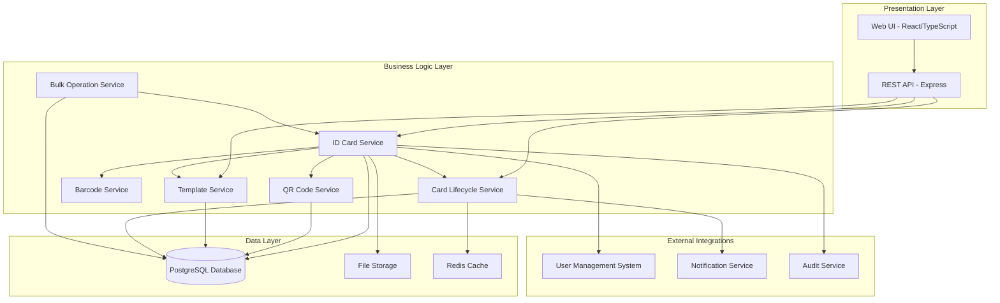
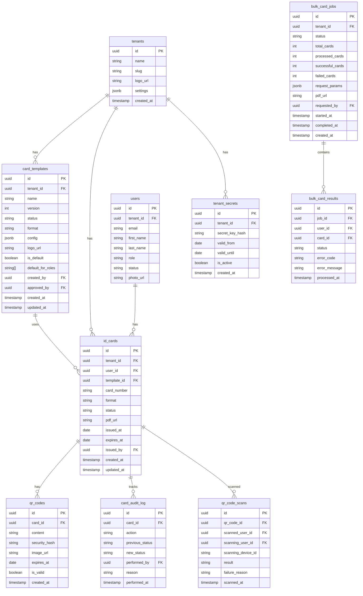

# Design Document: Identity Management Module

## Overview

The Identity Management Module is a comprehensive digital identification system integrated into the school management platform. It enables schools to generate, customize, manage, and track digital ID cards for students, teachers, and staff members throughout their complete lifecycle.

### Purpose and Scope

This module provides:
- **Digital ID Card Generation**: Create printable ID cards with photos, QR codes, and barcodes in multiple formats (PVC card, badge)
- **Secure QR Code System**: Generate tamper-resistant QR codes with cryptographic verification
- **Template Customization**: Design and manage reusable card templates with school branding
- **Bulk Operations**: Efficiently process large-scale card generation for entire classes or departments
- **Lifecycle Management**: Track cards from issuance through expiration, loss reporting, and revocation
- **Integration**: Seamlessly integrate with existing user management, authentication, and notification systems

### Key Business Drivers

1. **Security**: Prevent unauthorized access through secure, verifiable identification
2. **Efficiency**: Reduce manual ID card creation time from hours to minutes
3. **Compliance**: Maintain audit trails for security and regulatory requirements
4. **Branding**: Reflect institutional identity through customizable card designs
5. **Scalability**: Support bulk operations for organizations with thousands of users

### Technology Decisions

- **PDF Generation**: PDFKit for high-quality printable documents (300+ DPI)
- **QR Code**: qrcode npm package with error correction level H (30% damage recovery)
- **Barcode**: jsbarcode for Code 128, Code 39, and EAN-13 format support
- **Encryption**: AES-256 for photo storage, SHA-256 for QR code security hashes
- **Database**: PostgreSQL with JSONB for flexible template storage
- **File Storage**: Server filesystem or S3-compatible storage for PDFs and images

## Architecture

### System Architecture



### Architecture Patterns

**Service-Oriented Architecture**: Each major capability (card generation, QR codes, templates, lifecycle) is encapsulated in a dedicated service with clear interfaces.

**Repository Pattern**: Database operations are abstracted through repository interfaces, allowing service layer to focus on business logic.

**Event-Driven Updates**: Card lifecycle changes trigger events that update related systems (invalidate QR codes, send notifications).

**Tenant Isolation**: All operations enforce tenant boundaries through database constraints and service-level validation.

**Asynchronous Processing**: Bulk operations exceeding 50 cards execute asynchronously using job queues to prevent request timeouts.

### Scalability Considerations

1. **Horizontal Scaling**: Stateless services allow multiple instances behind load balancer
2. **Caching**: Redis caches frequently accessed templates and user data
3. **Asynchronous Jobs**: Bull queue system processes bulk card generation without blocking API
4. **CDN Delivery**: Generated PDFs can be served through CDN for faster distribution
5. **Database Optimization**: Indexes on frequently queried fields (user_id, tenant_id, status, expiration_date)

## Components and Interfaces

### ID Card Service

**Responsibilities:**
- Orchestrate card generation workflow
- Retrieve user data from User Management System
- Coordinate QR code and barcode generation
- Apply templates to create printable PDFs
- Store card metadata

**Public Interface:**
```typescript
interface IIdCardService {
  generateCard(userId: string, options: CardGenerationOptions): Promise<CardResult>;
  regenerateCard(cardId: string): Promise<CardResult>;
  getCardById(cardId: string): Promise<Card>;
  getCardsByUserId(userId: string): Promise<Card[]>;
  previewCard(userId: string, templateId: string): Promise<Buffer>;
}

interface CardGenerationOptions {
  templateId?: string;  // Optional, uses default if not provided
  format: 'pvc' | 'badge';
  expirationDate?: Date;  // Optional, defaults to 1 year
}

interface CardResult {
  cardId: string;
  userId: string;
  cardNumber: string;
  qrCode: string;
  barcode: string;
  pdfUrl: string;
  issuedAt: Date;
  expiresAt: Date;
}
```

**Dependencies:**
- QR Code Service
- Barcode Service
- Template Service
- User Management System
- File Storage
- Audit Service

### QR Code Service

**Responsibilities:**
- Generate secure QR codes with embedded security hashes
- Verify scanned QR codes
- Manage QR code expiration
- Invalidate QR codes when cards are revoked
- Log scan attempts for audit

**Public Interface:**
```typescript
interface IQrCodeService {
  generateQrCode(userId: string, expirationDate: Date): Promise<QrCodeData>;
  verifyQrCode(qrCodeContent: string): Promise<QrVerificationResult>;
  invalidateQrCode(qrCodeId: string): Promise<void>;
  rotateTenantSecret(tenantId: string): Promise<void>;
  logScan(scanData: ScanLog): Promise<void>;
}

interface QrCodeData {
  qrCodeId: string;
  content: string;  // Encoded data
  imageDataUrl: string;  // Base64 encoded PNG
  securityHash: string;
}

interface QrVerificationResult {
  isValid: boolean;
  userId?: string;
  userName?: string;
  role?: string;
  expirationDate?: Date;
  failureReason?: string;
}

interface ScanLog {
  scannedUserId: string;
  scanningUserId: string;
  scanningDeviceId: string;
  timestamp: Date;
  result: 'success' | 'invalid_hash' | 'expired' | 'revoked';
}
```

**Security Features:**
- SHA-256 security hash with tenant-specific secret
- Rate limiting: 10 requests/minute per device
- Brute-force protection: 5 failed attempts = 15 minute block
- 90-day secret rotation with automatic QR code updates

### Barcode Service

**Responsibilities:**
- Generate traditional barcodes in multiple formats
- Validate user IDs are compatible with barcode format
- Render barcodes with human-readable text

**Public Interface:**
```typescript
interface IBarcodeService {
  generateBarcode(userId: string, format: BarcodeFormat): Promise<BarcodeData>;
  validateUserIdForFormat(userId: string, format: BarcodeFormat): boolean;
}

type BarcodeFormat = 'CODE128' | 'CODE39' | 'EAN13';

interface BarcodeData {
  format: BarcodeFormat;
  content: string;
  imageDataUrl: string;  // Base64 encoded PNG
}
```

**Format Selection Logic:**
- Default: Code 128 (alphanumeric support, high density)
- Legacy systems: Code 39 or EAN-13 as configured per tenant

### Template Service

**Responsibilities:**
- Create and manage card templates
- Validate template configurations
- Handle school logo uploads
- Manage template versioning
- Enforce approval workflows

**Public Interface:**
```typescript
interface ITemplateService {
  createTemplate(template: TemplateCreateRequest): Promise<Template>;
  updateTemplate(templateId: string, updates: TemplateUpdateRequest): Promise<Template>;
  getTemplateById(templateId: string): Promise<Template>;
  getTemplatesByTenant(tenantId: string): Promise<Template[]>;
  getDefaultTemplate(tenantId: string, role: UserRole): Promise<Template>;
  setDefaultTemplate(templateId: string, role: UserRole): Promise<void>;
  submitForApproval(templateId: string): Promise<void>;
  approveTemplate(templateId: string, approverId: string): Promise<void>;
  deleteTemplate(templateId: string): Promise<void>;
  uploadLogo(tenantId: string, logoFile: Buffer): Promise<string>;
}

interface TemplateCreateRequest {
  tenantId: string;
  name: string;
  description?: string;
  format: 'pvc' | 'badge';
  backgroundColor: string;
  textColor: string;
  fontFamily: string;
  fontSize: number;
  logoPosition: 'top-left' | 'top-center' | 'top-right';
  layoutConfig: TemplateLayout;
}

interface TemplateLayout {
  photoPosition: { x: number; y: number; width: number; height: number };
  namePosition: { x: number; y: number };
  rolePosition: { x: number; y: number };
  idPosition: { x: number; y: number };
  qrCodePosition: { x: number; y: number; size: number };
  barcodePosition: { x: number; y: number };
}

interface Template {
  templateId: string;
  tenantId: string;
  name: string;
  version: number;
  status: 'draft' | 'pending_approval' | 'approved' | 'archived';
  format: 'pvc' | 'badge';
  config: TemplateCreateRequest;
  logoUrl?: string;
  isDefault: boolean;
  defaultForRoles: UserRole[];
  createdBy: string;
  approvedBy?: string;
  createdAt: Date;
  updatedAt: Date;
}
```

**Validation Rules:**
- Color contrast ratio ≥ 4.5:1 (WCAG AA)
- Logo file size ≤ 5MB
- Logo format: PNG or JPEG only
- Cannot delete templates used by active cards

### Card Lifecycle Service

**Responsibilities:**
- Manage card status transitions
- Track issue and expiration dates
- Handle loss reports and revocations
- Send expiration notifications
- Maintain audit trail

**Public Interface:**
```typescript
interface ICardLifecycleService {
  issueCard(cardId: string, issuedBy: string): Promise<void>;
  reportLost(cardId: string, reportedBy: string, reason?: string): Promise<void>;
  revokeCard(cardId: string, revokedBy: string, reason: string): Promise<void>;
  suspendCard(cardId: string, suspendedBy: string, reason: string): Promise<void>;
  reactivateCard(cardId: string, reactivatedBy: string): Promise<void>;
  expireCard(cardId: string): Promise<void>;
  getCardHistory(cardId: string): Promise<CardHistoryEntry[]>;
  checkExpiringSoon(tenantId: string, daysThreshold: number): Promise<Card[]>;
}

interface CardHistoryEntry {
  cardId: string;
  action: 'issued' | 'lost' | 'revoked' | 'suspended' | 'reactivated' | 'expired';
  performedBy: string;
  reason?: string;
  timestamp: Date;
  previousStatus?: CardStatus;
  newStatus: CardStatus;
}

type CardStatus = 'active' | 'expired' | 'lost' | 'revoked' | 'suspended';
```

**Status Transition Rules:**
- `active` → `lost`, `revoked`, `suspended`, `expired`
- `suspended` → `active`, `revoked`, `expired`
- `lost` → `revoked` (when reissuing)
- `expired` → (terminal state, cannot transition)
- `revoked` → (terminal state, cannot transition)

### Bulk Operation Service

**Responsibilities:**
- Validate bulk request inputs
- Coordinate asynchronous processing
- Generate multi-card PDF documents
- Report progress and errors
- Limit concurrent operations

**Public Interface:**
```typescript
interface IBulkOperationService {
  createBulkJob(request: BulkCardRequest): Promise<BulkJobResult>;
  getBulkJobStatus(jobId: string): Promise<BulkJobStatus>;
  cancelBulkJob(jobId: string): Promise<void>;
  getBulkJobReport(jobId: string): Promise<BulkJobReport>;
}

interface BulkCardRequest {
  tenantId: string;
  userIds?: string[];  // Explicit list
  filters?: BulkFilterCriteria;  // Or filter criteria
  templateId?: string;
  format: 'pvc' | 'badge';
  requestedBy: string;
}

interface BulkFilterCriteria {
  classId?: string;
  departmentId?: string;
  role?: UserRole;
  customQuery?: Record<string, any>;
}

interface BulkJobResult {
  jobId: string;
  estimatedCardCount: number;
  status: 'queued' | 'processing' | 'completed' | 'failed';
  createdAt: Date;
}

interface BulkJobStatus {
  jobId: string;
  status: 'queued' | 'processing' | 'completed' | 'failed';
  totalCards: number;
  processedCards: number;
  successfulCards: number;
  failedCards: number;
  progress: number;  // 0-100
  pdfUrl?: string;  // Available when completed
  startedAt?: Date;
  completedAt?: Date;
}

interface BulkJobReport {
  jobId: string;
  totalRequested: number;
  successful: SuccessEntry[];
  failed: FailureEntry[];
  pdfUrl: string;
  generatedAt: Date;
}

interface SuccessEntry {
  userId: string;
  userName: string;
  cardId: string;
  cardNumber: string;
}

interface FailureEntry {
  userId: string;
  userName?: string;
  errorCode: string;
  errorMessage: string;
}
```

**Concurrency Control:**
- Maximum 3 concurrent bulk jobs per tenant
- Jobs exceeding 50 cards execute asynchronously
- Queued jobs notify requester via email/notification when complete

## Data Models

### Database Schema



### Table Definitions

#### card_templates
```sql
CREATE TABLE card_templates (
    id UUID PRIMARY KEY DEFAULT gen_random_uuid(),
    tenant_id UUID NOT NULL REFERENCES tenants(id) ON DELETE CASCADE,
    name VARCHAR(100) NOT NULL,
    version INT NOT NULL DEFAULT 1,
    status VARCHAR(50) NOT NULL DEFAULT 'draft',
    format VARCHAR(20) NOT NULL CHECK (format IN ('pvc', 'badge')),
    config JSONB NOT NULL,
    logo_url VARCHAR(500),
    is_default BOOLEAN DEFAULT FALSE,
    default_for_roles TEXT[],
    created_by UUID NOT NULL REFERENCES users(id),
    approved_by UUID REFERENCES users(id),
    created_at TIMESTAMP NOT NULL DEFAULT NOW(),
    updated_at TIMESTAMP NOT NULL DEFAULT NOW(),
    
    CONSTRAINT valid_status CHECK (status IN ('draft', 'pending_approval', 'approved', 'archived')),
    CONSTRAINT valid_contrast CHECK ((config->>'backgroundColor') IS NOT NULL AND (config->>'textColor') IS NOT NULL)
);

CREATE INDEX idx_card_templates_tenant ON card_templates(tenant_id);
CREATE INDEX idx_card_templates_status ON card_templates(status);
CREATE INDEX idx_card_templates_default ON card_templates(is_default) WHERE is_default = TRUE;
```

#### id_cards
```sql
CREATE TABLE id_cards (
    id UUID PRIMARY KEY DEFAULT gen_random_uuid(),
    tenant_id UUID NOT NULL REFERENCES tenants(id) ON DELETE CASCADE,
    user_id UUID NOT NULL REFERENCES users(id) ON DELETE CASCADE,
    template_id UUID NOT NULL REFERENCES card_templates(id),
    card_number VARCHAR(50) NOT NULL UNIQUE,
    format VARCHAR(20) NOT NULL CHECK (format IN ('pvc', 'badge')),
    status VARCHAR(50) NOT NULL DEFAULT 'active',
    pdf_url VARCHAR(500),
    issued_at DATE NOT NULL,
    expires_at DATE NOT NULL,
    issued_by UUID NOT NULL REFERENCES users(id),
    created_at TIMESTAMP NOT NULL DEFAULT NOW(),
    updated_at TIMESTAMP NOT NULL DEFAULT NOW(),
    
    CONSTRAINT valid_status CHECK (status IN ('active', 'expired', 'lost', 'revoked', 'suspended')),
    CONSTRAINT valid_dates CHECK (expires_at > issued_at)
);

CREATE INDEX idx_id_cards_tenant ON id_cards(tenant_id);
CREATE INDEX idx_id_cards_user ON id_cards(user_id);
CREATE INDEX idx_id_cards_status ON id_cards(status);
CREATE INDEX idx_id_cards_expires ON id_cards(expires_at) WHERE status = 'active';
CREATE UNIQUE INDEX idx_id_cards_active_per_user ON id_cards(user_id) WHERE status = 'active';
```

#### qr_codes
```sql
CREATE TABLE qr_codes (
    id UUID PRIMARY KEY DEFAULT gen_random_uuid(),
    card_id UUID NOT NULL REFERENCES id_cards(id) ON DELETE CASCADE,
    content TEXT NOT NULL,
    security_hash VARCHAR(64) NOT NULL,
    image_url VARCHAR(500),
    expires_at DATE NOT NULL,
    is_valid BOOLEAN DEFAULT TRUE,
    created_at TIMESTAMP NOT NULL DEFAULT NOW()
);

CREATE INDEX idx_qr_codes_card ON qr_codes(card_id);
CREATE INDEX idx_qr_codes_valid ON qr_codes(is_valid) WHERE is_valid = TRUE;
CREATE INDEX idx_qr_codes_hash ON qr_codes(security_hash);
```

#### tenant_secrets
```sql
CREATE TABLE tenant_secrets (
    id UUID PRIMARY KEY DEFAULT gen_random_uuid(),
    tenant_id UUID NOT NULL REFERENCES tenants(id) ON DELETE CASCADE,
    secret_key_hash VARCHAR(255) NOT NULL,
    valid_from DATE NOT NULL,
    valid_until DATE NOT NULL,
    is_active BOOLEAN DEFAULT TRUE,
    created_at TIMESTAMP NOT NULL DEFAULT NOW(),
    
    CONSTRAINT valid_dates CHECK (valid_until > valid_from)
);

CREATE INDEX idx_tenant_secrets_tenant ON tenant_secrets(tenant_id);
CREATE INDEX idx_tenant_secrets_active ON tenant_secrets(is_active) WHERE is_active = TRUE;
```

#### card_audit_log
```sql
CREATE TABLE card_audit_log (
    id UUID PRIMARY KEY DEFAULT gen_random_uuid(),
    card_id UUID NOT NULL REFERENCES id_cards(id) ON DELETE CASCADE,
    action VARCHAR(50) NOT NULL,
    previous_status VARCHAR(50),
    new_status VARCHAR(50),
    performed_by UUID NOT NULL REFERENCES users(id),
    reason TEXT,
    performed_at TIMESTAMP NOT NULL DEFAULT NOW(),
    
    CONSTRAINT valid_action CHECK (action IN ('issued', 'lost', 'revoked', 'suspended', 'reactivated', 'expired', 'regenerated'))
);

CREATE INDEX idx_card_audit_card ON card_audit_log(card_id);
CREATE INDEX idx_card_audit_performed_at ON card_audit_log(performed_at);
```

#### qr_code_scans
```sql
CREATE TABLE qr_code_scans (
    id UUID PRIMARY KEY DEFAULT gen_random_uuid(),
    qr_code_id UUID REFERENCES qr_codes(id) ON DELETE SET NULL,
    scanned_user_id UUID REFERENCES users(id),
    scanning_user_id UUID NOT NULL REFERENCES users(id),
    scanning_device_id VARCHAR(100) NOT NULL,
    result VARCHAR(50) NOT NULL,
    failure_reason TEXT,
    scanned_at TIMESTAMP NOT NULL DEFAULT NOW(),
    
    CONSTRAINT valid_result CHECK (result IN ('success', 'invalid_hash', 'expired', 'revoked', 'not_found'))
);

CREATE INDEX idx_qr_scans_device ON qr_code_scans(scanning_device_id, scanned_at);
CREATE INDEX idx_qr_scans_result ON qr_code_scans(result, scanned_at);
```

#### bulk_card_jobs
```sql
CREATE TABLE bulk_card_jobs (
    id UUID PRIMARY KEY DEFAULT gen_random_uuid(),
    tenant_id UUID NOT NULL REFERENCES tenants(id) ON DELETE CASCADE,
    status VARCHAR(50) NOT NULL DEFAULT 'queued',
    total_cards INT NOT NULL DEFAULT 0,
    processed_cards INT NOT NULL DEFAULT 0,
    successful_cards INT NOT NULL DEFAULT 0,
    failed_cards INT NOT NULL DEFAULT 0,
    request_params JSONB NOT NULL,
    pdf_url VARCHAR(500),
    requested_by UUID NOT NULL REFERENCES users(id),
    started_at TIMESTAMP,
    completed_at TIMESTAMP,
    created_at TIMESTAMP NOT NULL DEFAULT NOW(),
    
    CONSTRAINT valid_status CHECK (status IN ('queued', 'processing', 'completed', 'failed', 'cancelled'))
);

CREATE INDEX idx_bulk_jobs_tenant ON bulk_card_jobs(tenant_id);
CREATE INDEX idx_bulk_jobs_status ON bulk_card_jobs(status);
CREATE INDEX idx_bulk_jobs_requested_by ON bulk_card_jobs(requested_by);
```

#### bulk_card_results
```sql
CREATE TABLE bulk_card_results (
    id UUID PRIMARY KEY DEFAULT gen_random_uuid(),
    job_id UUID NOT NULL REFERENCES bulk_card_jobs(id) ON DELETE CASCADE,
    user_id UUID NOT NULL REFERENCES users(id),
    card_id UUID REFERENCES id_cards(id),
    status VARCHAR(50) NOT NULL,
    error_code VARCHAR(100),
    error_message TEXT,
    processed_at TIMESTAMP NOT NULL DEFAULT NOW(),
    
    CONSTRAINT valid_status CHECK (status IN ('success', 'failed'))
);

CREATE INDEX idx_bulk_results_job ON bulk_card_results(job_id);
CREATE INDEX idx_bulk_results_status ON bulk_card_results(status);
```

### Data Model Relationships

**Tenant Isolation**: All primary entities (card_templates, id_cards, bulk_card_jobs) reference tenant_id with CASCADE delete to ensure complete data isolation and cleanup.

**User References**: id_cards.user_id links to the users table. The system supports users in multiple roles (student, teacher, staff) through the users.role field.

**Template Versioning**: card_templates.version increments on updates. Historical cards retain reference to the template version used.

**One Active Card Per User**: Unique index on id_cards(user_id) WHERE status = 'active' ensures users can only have one active card at a time.

**QR Code Relationship**: Each id_card has one qr_code. When a card is revoked, qr_codes.is_valid is set to FALSE.

**Audit Trail**: card_audit_log captures all status transitions with full context (who, when, why).

**Secret Rotation**: tenant_secrets table supports multiple active secrets during rotation window (old and new secrets both valid for 24 hours during transition).


## Correctness Properties

*A property is a characteristic or behavior that should hold true across all valid executions of a system—essentially, a formal statement about what the system should do. Properties serve as the bridge between human-readable specifications and machine-verifiable correctness guarantees.*

### Property Reflection Analysis

After analyzing all acceptance criteria, I identified the following properties suitable for property-based testing. Several properties were consolidated to eliminate redundancy:

**Consolidated Properties:**
- QR code generation and verification (2.1, 2.5) → Combined into QR code round-trip property
- Card status transitions (6.3, 6.4) → Combined into general state transition property
- Audit logging (6.7, 7.3, 7.8) → Combined into comprehensive audit logging property
- Template/QR serialization (10.1, 10.2, 10.4) and (10.5, 10.6, 10.9) → Two round-trip properties

**Properties Excluded (not suitable for PBT):**
- PDF generation and layout (testing via snapshot tests)
- Performance requirements (testing via load tests)
- Infrastructure integration (testing via integration tests)
- UI accessibility (testing via manual audit + automated accessibility tools)

### Property 1: QR Code Encoding/Decoding Round-Trip

*For any* valid QR code data structure containing user ID, name, role, and security hash, encoding the data to string format then decoding it back SHALL produce an equivalent data structure with all fields preserved.

**Validates: Requirements 2.1, 2.5, 10.5, 10.6, 10.9**

**Rationale**: This property ensures the QR code serialization/deserialization logic is lossless and maintains data integrity across the encode/decode cycle. Any corruption or data loss during encoding would be caught by property-based testing across thousands of randomly generated user data structures.

### Property 2: QR Code Security Hash Verification

*For any* QR code data with a correctly generated security hash using the tenant secret, the verification function SHALL accept the QR code as valid, and *for any* QR code where the security hash has been corrupted or tampered with, the verification function SHALL reject it with failure reason "invalid_hash".

**Validates: Requirements 2.4, 2.5, 2.6**

**Rationale**: This property verifies the cryptographic integrity of the security system. The first clause ensures no false negatives (valid codes are accepted), and the second ensures no false positives (tampered codes are rejected).

### Property 3: QR Code Expiration Enforcement

*For any* QR code with an expiration date in the past relative to the current verification time, the verification function SHALL reject it with failure reason "expired".

**Validates: Requirements 2.7**

**Rationale**: This ensures time-based access control is correctly enforced. Testing with various expiration dates (past, present, future) validates the temporal logic.

### Property 4: Barcode Format Validation

*For any* user ID and barcode format (CODE128, CODE39, EAN13), the validation function SHALL correctly determine whether the user ID is compatible with that format's character set and length constraints.

**Validates: Requirements 3.5**

**Rationale**: This property ensures input validation correctly implements the format-specific rules. Property testing with various user ID patterns (numeric, alphanumeric, special characters) verifies comprehensive validation coverage.

### Property 5: Barcode Encoding/Decoding Round-Trip

*For any* valid user ID and barcode format, generating a barcode image then decoding it SHALL produce the original user ID value.

**Validates: Requirements 3.1**

**Rationale**: This validates the barcode generation library integration is configured correctly and produces scannable output. The round-trip property ensures encoding is reversible.

### Property 6: Template Color Contrast Validation

*For any* pair of background and text colors, the contrast validation function SHALL correctly calculate the contrast ratio and accept colors with ratio ≥ 4.5:1 and reject colors with ratio < 4.5:1 according to WCAG 2.1 formula.

**Validates: Requirements 4.3**

**Rationale**: This ensures accessibility compliance through correct implementation of the WCAG contrast formula. Property testing with random color combinations validates the mathematical correctness.

### Property 7: Template Logo Aspect Ratio Preservation

*For any* logo image with original dimensions (width, height), resizing the image to fit within card dimensions SHALL preserve the aspect ratio such that (resized_width / resized_height) equals (original_width / original_height) within a tolerance of 0.01.

**Validates: Requirements 4.5**

**Rationale**: This property ensures image transformations don't distort logos. Testing with various aspect ratios validates the resize algorithm maintains proportions.

### Property 8: Template Default Uniqueness

*For any* tenant with multiple card templates, querying the default template for a specific role SHALL return exactly one template marked as default for that role.

**Validates: Requirements 4.6**

**Rationale**: This enforces the business rule that each role has a single default template. Property testing with various template configurations ensures the constraint is maintained.

### Property 9: Template Deletion Protection

*For any* card template that has been used to generate one or more cards with status 'active', attempting to delete that template SHALL fail with an appropriate error, and *for any* template that has not been used or has only been used for non-active cards, deletion SHALL succeed.

**Validates: Requirements 4.8**

**Rationale**: This property protects referential integrity and historical data. Testing with various template usage scenarios validates the protection logic.

### Property 10: Template Version Increment

*For any* card template, performing N update operations SHALL result in the version field increasing by N (from initial version V to version V+N).

**Validates: Requirements 4.9**

**Rationale**: This ensures version tracking is consistent. Property testing with sequences of updates verifies the increment logic.

### Property 11: Template JSON Serialization Round-Trip

*For any* valid card template configuration object, serializing it to JSON then deserializing back to an object SHALL produce an equivalent configuration with all fields preserved.

**Validates: Requirements 10.1, 10.2, 10.4**

**Rationale**: This is the classic round-trip property for serialization. Testing with diverse template configurations ensures the JSON serialization is lossless.

### Property 12: Bulk Operation User Validation

*For any* bulk card generation request containing a list of user IDs, if all user IDs exist and have status 'active', then validation SHALL succeed, and if any user ID is invalid or inactive, then validation SHALL fail before processing begins.

**Validates: Requirements 5.2**

**Rationale**: This property ensures bulk operations validate inputs completely before starting expensive processing. Testing with various combinations of valid/invalid users validates early failure behavior.

### Property 13: Bulk Operation Card Generation Completeness

*For any* bulk card generation request with N valid user IDs that completes successfully, the operation SHALL generate exactly N cards, one for each requested user.

**Validates: Requirements 5.1**

**Rationale**: This ensures bulk operations don't skip or duplicate cards. Property testing with various batch sizes validates completeness.

### Property 14: Bulk Operation Error Resilience

*For any* bulk card generation request where K out of N users have issues preventing card generation, the operation SHALL complete with (N-K) successful cards and a report listing all K failures with error details.

**Validates: Requirements 5.5**

**Rationale**: This property validates error handling doesn't abort the entire batch. Testing with partial failures ensures resilient processing.

### Property 15: Bulk Operation Report Completeness

*For any* completed bulk card generation job that processed N users, the summary report SHALL contain exactly N entries (success or failure), each with a user ID and status.

**Validates: Requirements 5.7**

**Rationale**: This ensures reporting is comprehensive and matches actual processing. Property testing with various job outcomes validates report accuracy.

### Property 16: Card Lifecycle Initial State

*For any* newly generated card, the initial status SHALL be 'active' and the issued_at date SHALL be set to the current date.

**Validates: Requirements 6.1**

**Rationale**: This validates correct initialization of card state. Property testing with various card generation scenarios ensures consistent initialization.

### Property 17: Card Lifecycle Expiration Date Calculation

*For any* newly generated card with issue date D, the expiration date SHALL be exactly 1 year from D (D + 365 days), and the issued_by field SHALL reference the user who requested generation.

**Validates: Requirements 6.2**

**Rationale**: This ensures date arithmetic is correct and metadata is tracked. Property testing with various issue dates validates the calculation.

### Property 18: Card Status Transition with QR Code Invalidation

*For any* active card, when the status is transitioned to 'lost', 'revoked', or 'suspended', the associated QR code's is_valid flag SHALL be set to FALSE, and *for any* suspended card reactivated to 'active', the QR code SHALL be regenerated with is_valid=TRUE.

**Validates: Requirements 6.3, 6.4, 2.8**

**Rationale**: This property ensures state transitions correctly trigger side effects. Testing various status transitions validates the synchronization between cards and QR codes.

### Property 19: Card Expiration Date Enforcement

*For any* card where the current date is greater than or equal to the expires_at date, running the expiration check process SHALL update the status to 'expired'.

**Validates: Requirements 6.5**

**Rationale**: This validates the automated expiration logic correctly identifies and updates expired cards based on date comparison.

### Property 20: Card Reissuance Revocation

*For any* user with an existing card of status 'active', reissuing a new card SHALL create a new card with status 'active' and update the old card's status to 'revoked' atomically.

**Validates: Requirements 6.6**

**Rationale**: This property ensures card reissuance maintains the one-active-card-per-user invariant through proper state transitions.

### Property 21: Card Audit Trail Completeness

*For any* card status transition, audit log entry creation, or export operation, a corresponding record SHALL be created in the appropriate audit table with timestamp, performing user ID, action type, and relevant details.

**Validates: Requirements 6.7, 7.3, 7.8**

**Rationale**: This comprehensive audit property ensures all auditable events are logged. Property testing with various operations validates logging coverage.

### Property 22: Card History Chronological Ordering

*For any* user with N historical cards (N ≥ 1), retrieving the card history SHALL return all N cards sorted by issued_at date in ascending chronological order.

**Validates: Requirements 6.9**

**Rationale**: This validates query logic correctly retrieves and sorts historical data. Property testing with various card creation sequences ensures sort stability.

### Property 23: Security Hash Tenant Isolation

*For any* two users belonging to different tenants, generating security hashes with the same user data but different tenant secrets SHALL produce different hash values.

**Validates: Requirements 7.1**

**Rationale**: This property ensures tenant isolation at the cryptographic level. Testing with same user data across tenants validates proper secret usage.

### Property 24: Photo Encryption at Rest

*For any* user photo data, after storing it to the database, retrieving the raw database value SHALL NOT equal the original plaintext photo data (indicating encryption), and decrypting the stored value SHALL equal the original photo data.

**Validates: Requirements 7.6**

**Rationale**: This validates encryption/decryption is correctly applied to sensitive data. Property testing with various photo data ensures encryption is consistent.

### Property 25: User Status Change Card Revocation

*For any* user with an active card, when the user's status is changed to 'inactive' or 'deleted', the card's status SHALL automatically be updated to 'revoked'.

**Validates: Requirements 8.3**

**Rationale**: This property ensures cascade logic maintains data integrity when users are deactivated. Testing with various user status changes validates the cascade behavior.

### Property 26: Tenant Data Isolation

*For any* tenant-scoped query for cards or templates, all returned records SHALL have a tenant_id matching the query tenant, and NO records from other tenants SHALL be included in results.

**Validates: Requirements 8.4**

**Rationale**: This critical security property ensures complete data isolation. Property testing with multi-tenant data validates isolation is enforced at the query level.

### Property 27: Report Date Range Filtering

*For any* card issuance report with specified start and end dates [D1, D2], all returned cards SHALL have issued_at dates within the range D1 ≤ issued_at ≤ D2, and NO cards outside this range SHALL be included.

**Validates: Requirements 9.2**

**Rationale**: This validates date filtering logic in reporting queries. Property testing with various date ranges ensures boundary conditions are handled correctly.

### Property 28: Scan Count Aggregation

*For any* user with exactly N QR code scan log entries within a specified time period, querying the scan count for that user and period SHALL return N.

**Validates: Requirements 9.4**

**Rationale**: This property validates aggregation queries produce correct counts. Property testing with various scan patterns ensures counting logic is accurate.

### Property 29: Card Status Display Dual Encoding

*For any* card status value ('active', 'expired', 'lost', 'revoked', 'suspended'), rendering the status display SHALL include both a color indicator and a text label, ensuring status is conveyed through multiple sensory channels.

**Validates: Requirements 13.4**

**Rationale**: This accessibility property ensures status information is available to users who cannot perceive color. Property testing with all status values validates consistent dual encoding.

### Property 30: Print Configuration Persistence

*For any* user and print configuration settings, saving the configuration then retrieving the last-used configuration for that user SHALL return settings equal to the saved configuration.

**Validates: Requirements 11.5**

**Rationale**: This property validates user preference storage is reliable. Property testing with various configuration values ensures persistence is lossless.


## Error Handling

### Error Categories

The system implements comprehensive error handling across four categories:

#### 1. Validation Errors (4xx)

**Client-side errors** indicating invalid input or business rule violations:

- **400 Bad Request**: Malformed requests, missing required fields, invalid data types
- **403 Forbidden**: Insufficient permissions for requested operation
- **404 Not Found**: Referenced entity (user, card, template) doesn't exist
- **409 Conflict**: Business rule violation (duplicate card number, template in use, concurrent modification)
- **422 Unprocessable Entity**: Validation failures (contrast ratio too low, invalid barcode format, file size exceeded)
- **429 Too Many Requests**: Rate limit exceeded (QR code scans, bulk operation concurrency)

**Example Validation Error Response:**
```typescript
{
  "error": {
    "code": "VALIDATION_ERROR",
    "message": "Template validation failed",
    "details": [
      {
        "field": "textColor",
        "issue": "Insufficient contrast ratio",
        "constraint": "minimum 4.5:1",
        "actual": "2.1:1"
      }
    ],
    "timestamp": "2024-01-15T10:30:00Z",
    "requestId": "req_abc123"
  }
}
```

#### 2. System Errors (5xx)

**Server-side errors** indicating system failures:

- **500 Internal Server Error**: Unexpected failures in business logic
- **503 Service Unavailable**: External dependency unavailable (file storage, notification service)
- **504 Gateway Timeout**: Operation exceeded timeout threshold

**Error Recovery Actions:**
- Log full error details including stack trace
- Return sanitized error message to client (no sensitive details)
- Trigger alerts for repeated failures
- Rollback database transactions automatically

#### 3. Business Logic Errors

**Domain-specific failures** that don't fit HTTP status codes:

- `CARD_ALREADY_ACTIVE`: User already has an active card
- `TEMPLATE_IN_USE`: Cannot delete template used by active cards
- `QR_CODE_EXPIRED`: Scanned QR code has passed expiration date
- `QR_CODE_INVALID_HASH`: Security hash verification failed (possible tampering)
- `DEVICE_BLOCKED`: Scanning device temporarily blocked due to failed verification attempts
- `BULK_JOB_LIMIT_EXCEEDED`: Maximum concurrent bulk jobs reached for tenant
- `SECRET_ROTATION_IN_PROGRESS`: Cannot generate cards during secret key rotation

**Handling Strategy:**
- Return error with specific code and user-friendly message
- Log error for monitoring and analytics
- Provide recovery suggestions where applicable

#### 4. Parsing and Serialization Errors

**Data transformation failures:**

- `JSON_PARSE_ERROR`: Invalid JSON in template configuration
- `QR_DECODE_ERROR`: Cannot decode QR code content
- `TEMPLATE_SCHEMA_MISMATCH`: Template JSON doesn't match expected schema
- `BARCODE_DECODE_ERROR`: Barcode image cannot be decoded

**Error Details Format:**
```typescript
{
  "code": "JSON_PARSE_ERROR",
  "message": "Failed to parse template configuration",
  "location": "config.layoutConfig.photoPosition",
  "expected": "object with x, y, width, height",
  "received": "null",
  "input": "...<truncated>..."
}
```

### Error Handling Patterns

#### Service Layer Pattern

```typescript
class IdCardService {
  async generateCard(userId: string, options: CardGenerationOptions): Promise<CardResult> {
    try {
      // Input validation
      if (!userId) {
        throw new ValidationError('User ID is required', 'userId');
      }
      
      // Check business rules
      const existingCard = await this.getActiveCardByUserId(userId);
      if (existingCard) {
        throw new BusinessRuleError('CARD_ALREADY_ACTIVE', 
          `User ${userId} already has an active card`);
      }
      
      // Perform operation
      const user = await this.userService.getUserById(userId);
      if (!user) {
        throw new NotFoundError('User', userId);
      }
      
      // Generate card components
      const qrCode = await this.qrCodeService.generateQrCode(userId, options.expirationDate);
      const barcode = await this.barcodeService.generateBarcode(user.studentId || user.teacherId);
      
      // Create PDF
      const pdf = await this.renderCardPdf(user, qrCode, barcode, template);
      
      // Store metadata
      const card = await this.db.transaction(async (trx) => {
        const cardId = await trx('id_cards').insert({ /* ... */ });
        await trx('card_audit_log').insert({ /* ... */ });
        return cardId;
      });
      
      return card;
      
    } catch (error) {
      // Log error with context
      logger.error('Card generation failed', {
        userId,
        options,
        error: error.message,
        stack: error.stack
      });
      
      // Rethrow with context if needed
      if (error instanceof AppError) {
        throw error;
      }
      
      throw new SystemError('Card generation failed', error);
    }
  }
}
```

#### Transaction Rollback

All database operations that modify multiple tables use transactions with automatic rollback on error:

```typescript
async reissueCard(userId: string): Promise<Card> {
  return await this.db.transaction(async (trx) => {
    // Revoke old card
    await trx('id_cards')
      .where({ user_id: userId, status: 'active' })
      .update({ status: 'revoked', updated_at: new Date() });
    
    // Invalidate old QR codes
    await trx('qr_codes')
      .whereIn('card_id', trx('id_cards').select('id').where({ user_id: userId }))
      .update({ is_valid: false });
    
    // Create new card
    const [newCardId] = await trx('id_cards').insert({ /* ... */ });
    
    // Log audit trail
    await trx('card_audit_log').insert({
      card_id: newCardId,
      action: 'reissued',
      performed_by: currentUser.id
    });
    
    return newCardId;
  });
  // If any operation fails, entire transaction is rolled back
}
```

#### Retry Logic for External Dependencies

Operations that depend on external services (file storage, email) implement exponential backoff retry:

```typescript
async uploadCardPdf(pdfBuffer: Buffer, cardId: string): Promise<string> {
  const maxRetries = 3;
  const baseDelay = 1000; // 1 second
  
  for (let attempt = 1; attempt <= maxRetries; attempt++) {
    try {
      const url = await this.storageService.upload(pdfBuffer, `cards/${cardId}.pdf`);
      return url;
    } catch (error) {
      if (attempt === maxRetries) {
        throw new SystemError('Failed to upload PDF after retries', error);
      }
      
      const delay = baseDelay * Math.pow(2, attempt - 1);
      logger.warn(`Upload failed, retrying in ${delay}ms`, { attempt, error });
      await sleep(delay);
    }
  }
}
```

#### Graceful Degradation

Non-critical failures degrade gracefully rather than blocking operations:

```typescript
async generateCard(userId: string): Promise<CardResult> {
  const user = await this.userService.getUserById(userId);
  
  // If photo retrieval fails, use placeholder instead of failing entire operation
  let photo;
  try {
    photo = await this.storageService.getFile(user.photoUrl);
  } catch (error) {
    logger.warn('Failed to retrieve user photo, using placeholder', { userId, error });
    photo = await this.getPlaceholderPhoto(user.role);
  }
  
  // Continue with card generation
  // ...
}
```

### Monitoring and Alerting

**Error Metrics Tracked:**
- Error rate by error code (validation, business, system)
- Failed QR code verification attempts (security monitoring)
- Bulk job failure rate
- External dependency failure rate
- Average error recovery time

**Alert Thresholds:**
- > 10 failed QR verifications from same device in 5 minutes → Security alert
- > 5% bulk job failure rate → Operations alert
- > 1% system error rate (5xx) → Engineering alert
- External dependency unavailable > 5 minutes → Critical alert

## Testing Strategy

### Testing Approach Overview

The Identity Management Module employs a **comprehensive multi-layered testing strategy** combining property-based testing, example-based unit tests, integration tests, and end-to-end tests to ensure correctness, security, and reliability.

### 1. Property-Based Testing (PBT)

**Framework**: fast-check (TypeScript/JavaScript PBT library)

**Scope**: All 30 correctness properties defined in the Correctness Properties section

**Configuration**:
- Minimum 100 iterations per property test (due to randomization)
- Seed recording for reproducible failures
- Shrinking enabled to find minimal failing examples
- Timeout: 30 seconds per property test

**Property Test Structure**:
```typescript
import fc from 'fast-check';

/**
 * Feature: identity-management-module
 * Property 11: Template JSON Serialization Round-Trip
 * 
 * For any valid card template configuration object, serializing it to JSON
 * then deserializing back to an object SHALL produce an equivalent configuration
 * with all fields preserved.
 */
describe('Property 11: Template JSON Serialization Round-Trip', () => {
  it('should preserve all fields through serialize-deserialize cycle', () => {
    fc.assert(
      fc.property(
        // Custom generator for template configurations
        templateConfigurationArbitrary(),
        (template) => {
          // Serialize to JSON
          const json = JSON.stringify(template);
          
          // Deserialize back to object
          const parsed = JSON.parse(json);
          
          // Assert equivalence
          expect(parsed).toEqual(template);
          
          // Validate schema compliance
          expect(validateTemplateSchema(parsed)).toBe(true);
        }
      ),
      { numRuns: 100 }
    );
  });
});
```

**Custom Generators (Arbitraries)**:

Generators create random but valid test data:

```typescript
// User data generator
function userDataArbitrary(): fc.Arbitrary<UserData> {
  return fc.record({
    userId: fc.uuid(),
    firstName: fc.string({ minLength: 1, maxLength: 50 }),
    lastName: fc.string({ minLength: 1, maxLength: 50 }),
    role: fc.constantFrom('student', 'teacher', 'staff'),
    photoUrl: fc.option(fc.webUrl(), { nil: null }) // Sometimes null
  });
}

// Template configuration generator
function templateConfigurationArbitrary(): fc.Arbitrary<TemplateConfig> {
  return fc.record({
    backgroundColor: colorArbitrary(),
    textColor: colorArbitrary(),
    fontFamily: fc.constantFrom('Arial', 'Helvetica', 'Times New Roman'),
    fontSize: fc.integer({ min: 8, max: 24 }),
    logoPosition: fc.constantFrom('top-left', 'top-center', 'top-right'),
    layoutConfig: layoutArbitrary()
  });
}

// Color generator (hex format)
function colorArbitrary(): fc.Arbitrary<string> {
  return fc.hexaString({ minLength: 6, maxLength: 6 })
    .map(hex => `#${hex}`);
}

// QR code data generator
function qrCodeDataArbitrary(): fc.Arbitrary<QrCodeData> {
  return fc.record({
    userId: fc.uuid(),
    name: fc.string({ minLength: 1, maxLength: 100 }),
    role: fc.constantFrom('student', 'teacher', 'staff'),
    expirationDate: fc.date({ min: new Date(), max: new Date('2030-12-31') }),
    securityHash: fc.hexaString({ minLength: 64, maxLength: 64 })
  });
}
```

**Key Properties to Test with PBT**:

- Round-trip properties (serialization, QR encoding, barcode encoding)
- Hash verification (valid and tampered)
- Validation logic (contrast ratio, barcode format compatibility)
- Date calculations (expiration, filtering)
- State transitions (card status changes with side effects)
- Aggregation queries (count, filtering, sorting)
- Data isolation (tenant boundaries)

### 2. Example-Based Unit Tests

**Framework**: Vitest (unit testing framework)

**Scope**: Specific scenarios, edge cases, and examples that complement property tests

**Examples**:

```typescript
describe('IdCardService', () => {
  describe('generateCard', () => {
    it('should generate card with PVC format dimensions', async () => {
      const userId = 'user-123';
      const result = await idCardService.generateCard(userId, { format: 'pvc' });
      
      const pdfInfo = await getPdfInfo(result.pdfUrl);
      expect(pdfInfo.width).toBe(85.6); // mm
      expect(pdfInfo.height).toBe(53.98); // mm
      expect(pdfInfo.dpi).toBeGreaterThanOrEqual(300);
    });
    
    it('should use placeholder image when user photo is missing', async () => {
      const user = await createTestUser({ photoUrl: null, role: 'student' });
      const result = await idCardService.generateCard(user.id, { format: 'pvc' });
      
      const pdf = await loadPdf(result.pdfUrl);
      expect(pdf).toContainImage('student_placeholder.png');
    });
    
    it('should throw CARD_ALREADY_ACTIVE when user has active card', async () => {
      const user = await createTestUser();
      await idCardService.generateCard(user.id, { format: 'pvc' });
      
      await expect(
        idCardService.generateCard(user.id, { format: 'pvc' })
      ).rejects.toThrow('CARD_ALREADY_ACTIVE');
    });
  });
});

describe('QrCodeService', () => {
  describe('rate limiting', () => {
    it('should block device after 5 failed verification attempts', async () => {
      const deviceId = 'device-123';
      const invalidQrCode = 'invalid-qr-content';
      
      // Make 5 failed attempts
      for (let i = 0; i < 5; i++) {
        await qrCodeService.verifyQrCode(invalidQrCode, deviceId);
      }
      
      // 6th attempt should be blocked
      const result = await qrCodeService.verifyQrCode(invalidQrCode, deviceId);
      expect(result.isValid).toBe(false);
      expect(result.failureReason).toBe('device_blocked');
    });
  });
});

describe('BulkOperationService', () => {
  describe('concurrency limits', () => {
    it('should reject 4th concurrent bulk job for same tenant', async () => {
      const tenantId = 'tenant-123';
      
      // Start 3 bulk jobs
      const job1 = await bulkService.createBulkJob({ tenantId, userIds: users1 });
      const job2 = await bulkService.createBulkJob({ tenantId, userIds: users2 });
      const job3 = await bulkService.createBulkJob({ tenantId, userIds: users3 });
      
      // 4th job should be rejected
      await expect(
        bulkService.createBulkJob({ tenantId, userIds: users4 })
      ).rejects.toThrow('BULK_JOB_LIMIT_EXCEEDED');
    });
  });
});
```

**Edge Cases to Cover**:
- Boundary values (minimum/maximum sizes, dates, counts)
- Null/undefined handling
- Empty collections
- Rate limiting thresholds
- Concurrency limits
- File size limits
- String length limits

### 3. Integration Tests

**Scope**: Component interactions, database operations, external service integrations

**Setup**: Test database with migrations, mocked external services

**Examples**:

```typescript
describe('Card Lifecycle Integration', () => {
  let db: Knex;
  let idCardService: IdCardService;
  let qrCodeService: QrCodeService;
  let notificationService: NotificationService;
  
  beforeAll(async () => {
    db = await createTestDatabase();
    await db.migrate.latest();
    
    notificationService = new MockNotificationService();
    qrCodeService = new QrCodeService(db);
    idCardService = new IdCardService(db, qrCodeService, notificationService);
  });
  
  afterAll(async () => {
    await db.destroy();
  });
  
  it('should revoke card and invalidate QR code when user is deactivated', async () => {
    // Create user and card
    const user = await createTestUser({ status: 'active' });
    const card = await idCardService.generateCard(user.id, { format: 'pvc' });
    
    // Verify card and QR code are active
    const initialCard = await db('id_cards').where('id', card.cardId).first();
    const initialQr = await db('qr_codes').where('card_id', card.cardId).first();
    expect(initialCard.status).toBe('active');
    expect(initialQr.is_valid).toBe(true);
    
    // Deactivate user
    await db('users').where('id', user.id).update({ status: 'inactive' });
    
    // Trigger cascade logic
    await cardLifecycleService.handleUserStatusChange(user.id, 'inactive');
    
    // Verify card is revoked and QR is invalid
    const finalCard = await db('id_cards').where('id', card.cardId).first();
    const finalQr = await db('qr_codes').where('card_id', card.cardId).first();
    expect(finalCard.status).toBe('revoked');
    expect(finalQr.is_valid).toBe(false);
    
    // Verify audit log entry
    const auditEntry = await db('card_audit_log')
      .where('card_id', card.cardId)
      .orderBy('performed_at', 'desc')
      .first();
    expect(auditEntry.action).toBe('revoked');
    expect(auditEntry.reason).toContain('user deactivated');
  });
  
  it('should rotate tenant secret and update all active QR codes', async () => {
    const tenantId = 'tenant-123';
    
    // Create multiple users with active cards
    const users = await Promise.all([
      createTestUser({ tenantId }),
      createTestUser({ tenantId }),
      createTestUser({ tenantId })
    ]);
    
    const cards = await Promise.all(
      users.map(u => idCardService.generateCard(u.id, { format: 'pvc' }))
    );
    
    // Get original QR codes
    const originalQrCodes = await db('qr_codes')
      .whereIn('card_id', cards.map(c => c.cardId))
      .select('*');
    
    // Trigger secret rotation
    await qrCodeService.rotateTenantSecret(tenantId);
    
    // Get updated QR codes
    const updatedQrCodes = await db('qr_codes')
      .whereIn('card_id', cards.map(c => c.cardId))
      .select('*');
    
    // Verify all security hashes changed
    for (let i = 0; i < originalQrCodes.length; i++) {
      expect(updatedQrCodes[i].security_hash).not.toBe(originalQrCodes[i].security_hash);
    }
    
    // Verify old secret is deactivated
    const oldSecret = await db('tenant_secrets')
      .where('tenant_id', tenantId)
      .orderBy('created_at', 'asc')
      .first();
    expect(oldSecret.is_active).toBe(false);
    
    // Verify new secret is active
    const newSecret = await db('tenant_secrets')
      .where('tenant_id', tenantId)
      .orderBy('created_at', 'desc')
      .first();
    expect(newSecret.is_active).toBe(true);
  });
});
```

### 4. End-to-End (E2E) Tests

**Framework**: Playwright (browser automation)

**Scope**: Full user workflows through UI

**Examples**:

```typescript
import { test, expect } from '@playwright/test';

test.describe('ID Card Management E2E', () => {
  test('Principal can create template and generate cards', async ({ page }) => {
    // Login as principal
    await page.goto('/login');
    await page.fill('[name="email"]', 'principal@school.com');
    await page.fill('[name="password"]', 'password');
    await page.click('button[type="submit"]');
    
    // Navigate to template management
    await page.click('text=ID Cards');
    await page.click('text=Templates');
    
    // Create new template
    await page.click('button:has-text("Create Template")');
    await page.fill('[name="name"]', 'Student Card 2024');
    await page.selectOption('[name="format"]', 'pvc');
    await page.fill('[name="backgroundColor"]', '#FFFFFF');
    await page.fill('[name="textColor"]', '#000000');
    await page.click('button:has-text("Save")');
    
    // Verify template created
    await expect(page.locator('text=Student Card 2024')).toBeVisible();
    
    // Generate card for student
    await page.click('text=Generate Cards');
    await page.fill('[name="search"]', 'John Doe');
    await page.click('text=John Doe');
    await page.selectOption('[name="template"]', 'Student Card 2024');
    await page.click('button:has-text("Generate")');
    
    // Wait for generation to complete
    await expect(page.locator('text=Card generated successfully')).toBeVisible();
    
    // Verify card appears in list
    await page.click('text=View Cards');
    await expect(page.locator('text=John Doe')).toBeVisible();
    await expect(page.locator('text=Active')).toBeVisible();
  });
  
  test('Admin can perform bulk card generation', async ({ page }) => {
    await loginAsAdmin(page);
    
    // Navigate to bulk generation
    await page.click('text=ID Cards');
    await page.click('text=Bulk Generate');
    
    // Select entire class
    await page.selectOption('[name="filterType"]', 'class');
    await page.selectOption('[name="class"]', 'Grade 10A');
    
    // Preview selection
    await page.click('button:has-text("Preview")');
    await expect(page.locator('text=30 students selected')).toBeVisible();
    
    // Start generation
    await page.click('button:has-text("Generate Cards")');
    
    // Wait for completion notification
    await expect(page.locator('text=Bulk generation completed')).toBeVisible({ timeout: 60000 });
    
    // Download PDF
    const downloadPromise = page.waitForEvent('download');
    await page.click('button:has-text("Download PDF")');
    const download = await downloadPromise;
    expect(download.suggestedFilename()).toContain('.pdf');
  });
});
```

### 5. Performance Tests

**Framework**: k6 (load testing tool)

**Scope**: Performance requirements validation

```javascript
import http from 'k6/http';
import { check, sleep } from 'k6';

export let options = {
  stages: [
    { duration: '1m', target: 10 }, // Ramp up to 10 concurrent users
    { duration: '3m', target: 10 }, // Stay at 10 users for 3 minutes
    { duration: '1m', target: 0 },  // Ramp down
  ],
  thresholds: {
    'http_req_duration': ['p(95)<3000'], // 95% of requests under 3s
    'http_req_failed': ['rate<0.01'],    // Less than 1% failures
  },
};

export default function() {
  // Test single card generation performance (Requirement 12.1)
  let res = http.post(`${__ENV.API_URL}/api/cards/generate`, JSON.stringify({
    userId: 'test-user-' + Math.floor(Math.random() * 1000),
    format: 'pvc'
  }), {
    headers: { 'Content-Type': 'application/json' },
  });
  
  check(res, {
    'card generation completes within 3s': (r) => r.timings.duration < 3000,
    'status is 200': (r) => r.status === 200,
  });
  
  sleep(1);
}
```

### 6. Security Tests

**Scope**: Security requirements validation

**Examples**:

```typescript
describe('Security Tests', () => {
  describe('QR Code Tampering Detection', () => {
    it('should detect modified user data in QR code', async () => {
      // Generate valid QR code
      const validQr = await qrCodeService.generateQrCode('user-123', new Date('2025-12-31'));
      
      // Decode and modify the content
      const decoded = decodeQrContent(validQr.content);
      decoded.userId = 'user-456'; // Tamper with user ID
      const tamperedContent = encodeQrContent(decoded);
      
      // Attempt verification
      const result = await qrCodeService.verifyQrCode(tamperedContent, 'device-123');
      
      expect(result.isValid).toBe(false);
      expect(result.failureReason).toBe('invalid_hash');
      
      // Verify scan logged for security monitoring
      const scanLog = await db('qr_code_scans')
        .where('scanning_device_id', 'device-123')
        .orderBy('scanned_at', 'desc')
        .first();
      expect(scanLog.result).toBe('invalid_hash');
    });
  });
  
  describe('Tenant Isolation', () => {
    it('should not allow cross-tenant card access', async () => {
      const tenant1User = await createTestUser({ tenantId: 'tenant-1' });
      const tenant2User = await createTestUser({ tenantId: 'tenant-2' });
      
      const tenant1Card = await idCardService.generateCard(tenant1User.id, { format: 'pvc' });
      
      // Attempt to access tenant1's card as tenant2 user
      await expect(
        idCardService.getCardById(tenant1Card.cardId, { tenantId: 'tenant-2' })
      ).rejects.toThrow('NOT_FOUND');
    });
  });
  
  describe('Photo Encryption', () => {
    it('should store photos encrypted in database', async () => {
      const photoData = Buffer.from('fake-image-data');
      const userId = 'user-123';
      
      // Store photo
      await storageService.storeUserPhoto(userId, photoData);
      
      // Retrieve raw database value
      const rawValue = await db('users')
        .where('id', userId)
        .select('photo_encrypted')
        .first();
      
      // Verify it's not plaintext
      expect(rawValue.photo_encrypted).not.toEqual(photoData);
      expect(rawValue.photo_encrypted).toBeTruthy();
      
      // Verify decryption returns original
      const decrypted = await storageService.getUserPhoto(userId);
      expect(decrypted).toEqual(photoData);
    });
  });
});
```

### Test Coverage Goals

**Target Coverage Metrics:**
- **Line Coverage**: ≥ 85% for all service layer code
- **Branch Coverage**: ≥ 80% for business logic
- **Property Test Coverage**: 100% of defined correctness properties (all 30 properties)
- **Integration Test Coverage**: All critical user workflows
- **E2E Test Coverage**: Top 10 user journeys by frequency

**Coverage Exclusions:**
- Generated code (migrations, type definitions)
- Third-party library code
- Framework boilerplate

### Continuous Integration

All tests run automatically on:
- Every pull request
- Every commit to main branch
- Nightly (full test suite including performance tests)

**CI Pipeline:**
1. Lint and type check
2. Unit tests (including property tests) - 5 minutes
3. Integration tests - 10 minutes
4. E2E tests - 15 minutes
5. Security scans (SAST, dependency audit) - 5 minutes
6. Performance tests (nightly only) - 30 minutes

**Quality Gates:**
- All tests must pass
- No new security vulnerabilities
- Coverage metrics maintained or improved
- Performance requirements met

