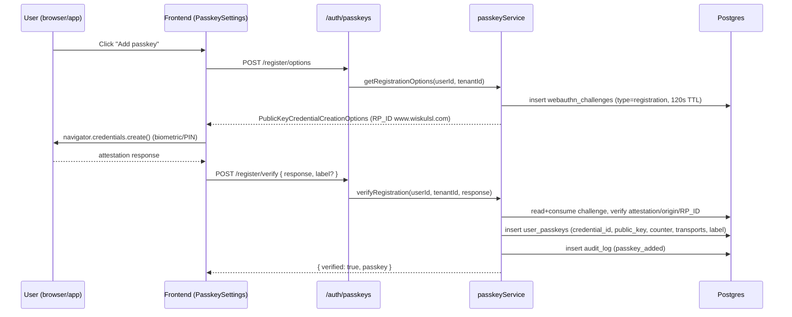

# Design Document — Passkey Authentication

## Overview

This design adds passkeys (WebAuthn/FIDO2) to WiSkul as an advanced, phishing-resistant
authentication method offered alongside the existing authenticator-app (TOTP) two-factor
flow. It reuses the current auth architecture as much as possible: the short-lived,
single-use, attempt-bounded challenge pattern already used by `twoFactorService`
(`mfa_challenges`), the `/api/v1/auth/*` route surface, the `AppError` error convention,
the audit-log pattern, and the existing MFA step in `LoginPage.tsx`.

Passkeys are implemented with `@simplewebauthn/server` (backend) and
`@simplewebauthn/browser` (frontend). The Relying Party ID (RP_ID) is fixed to
`www.wiskulsl.com`; the app (native Android / installed PWA) loads the live bundle from
that origin, so web, PWA, and native all present the same RP_ID.

Honest scope reminders (from requirements Non-Goals):
- **No offline login.** Every ceremony needs the server to issue and verify a challenge.
- **Password stays the base credential.** No passwordless-only accounts in this release.

## Architecture

### Where passkeys slot into the existing login flow

Today: `POST /auth/login` → if `two_factor_enabled`, returns an `mfa_token` → client
POSTs `/auth/2fa/verify-login { mfa_token, code }` → session tokens.

With passkeys, at the MFA step the client can choose **Use passkey** instead of typing a
TOTP/backup code. The passkey second-factor ceremony completes the *same* challenge and
issues the *same* session tokens, so downstream is unchanged. TOTP + backup codes remain
as the fallback (Requirement 7).

### Registration ceremony (from Security settings)



### Authentication ceremony (login second factor)

```mermaid
sequenceDiagram
    participant U as User (browser/app)
    participant FE as Frontend (LoginPage MFA step)
    participant API as /auth/passkeys
    participant S as passkeyService
    participant DB as Postgres

    Note over FE: User already passed password → holds mfa_token
    FE->>API: POST /authenticate/options { mfa_token }
    API->>S: getAuthenticationOptions(mfa_token)
    S->>DB: resolve user from mfa_challenge; list allowCredentials
    S->>DB: insert webauthn_challenges (type=authentication, 120s TTL)
    S-->>FE: PublicKeyCredentialRequestOptions
    FE->>U: navigator.credentials.get() (biometric/PIN)
    U-->>FE: assertion response
    FE->>API: POST /authenticate/verify { mfa_token, response }
    API->>S: verifyAuthentication(mfa_token, response)
    S->>DB: consume challenge; lookup credential in owning tenant
    S->>DB: verify assertion/origin/RP_ID; check+update counter (replay guard)
    S->>DB: consume mfa_challenge; update last_used_at; audit passkey_login
    S-->>FE: { accessToken, refreshToken, user }  (same shape as 2fa/verify-login)
```

## Components and Interfaces

### Backend: `passkeyService.ts` (new)

```ts
// backend/src/services/passkeyService.ts
interface RegistrationOptionsResult { options: PublicKeyCredentialCreationOptionsJSON; }
interface AuthOptionsResult { options: PublicKeyCredentialRequestOptionsJSON; }
interface PasskeyDTO {
  id: string; deviceLabel: string; createdAt: string; lastUsedAt: string | null;
}

class PasskeyService {
  // Registration (authenticated user)
  getRegistrationOptions(userId: string, tenantId: string): Promise<RegistrationOptionsResult>;
  verifyRegistration(userId: string, tenantId: string, response: RegistrationResponseJSON,
                     deviceLabel?: string): Promise<PasskeyDTO>;

  // Authentication as login second factor (resolves user via mfa_token)
  getAuthenticationOptions(mfaToken: string): Promise<AuthOptionsResult>;
  verifyAuthentication(mfaToken: string, response: AuthenticationResponseJSON):
    Promise<{ userId: string }>;   // caller (authService) issues session tokens

  // Management (authenticated, tenant-scoped)
  listPasskeys(userId: string, tenantId: string): Promise<PasskeyDTO[]>;
  renamePasskey(userId: string, tenantId: string, id: string, label: string): Promise<PasskeyDTO>;
  removePasskey(userId: string, tenantId: string, id: string): Promise<void>; // lockout guard
}
```

Key rules implemented in the service:
- RP_ID constant `www.wiskulsl.com`; expected origins = `https://www.wiskulsl.com` plus the
  Android `android:apk-key-hash:<base64url-sha256-cert>` origin (from env/config).
- Challenges: dedicated `webauthn_challenges` table (see Data Models), 120s TTL, single-use
  (deleted on success), tenant-bound. (Req 2, Req 6.)
- Counter replay guard: reject when `newCounter <= storedCounter` and `storedCounter > 0`
  (Req 6.6). Update counter on success (Req 4.6).
- Cross-tenant rejection: every credential lookup filters by `tenant_id`; reject if the
  resolved credential's tenant differs from the auth context (Req 6.7, 6.8).
- Per-credential lockout: 5 failed attempts / 300s window (Req 2.8) — tracked on the
  `user_passkeys` row (`failed_attempts`, `locked_until`).
- Remove guard: refuse to delete the last remaining second factor when a second factor is
  required (Req 3.7).
- Audit every add/rename/remove/login via the existing audit-log helper (Req 1.11, 3.8/3.9, 2.12).

### Backend routes (new) — mounted under existing `/api/v1/auth`

```
POST   /auth/passkeys/register/options       (auth required)   → creation options
POST   /auth/passkeys/register/verify        (auth required)   → { passkey }
POST   /auth/passkeys/authenticate/options   (public, needs mfa_token) → request options
POST   /auth/passkeys/authenticate/verify    (public, needs mfa_token) → session tokens
GET    /auth/passkeys                         (auth required)   → PasskeyDTO[]
PATCH  /auth/passkeys/:id                      (auth required)   → { passkey }  (rename)
DELETE /auth/passkeys/:id                      (auth required)   → { message }  (remove)
```

The `authenticate/*` routes are public (like `2fa/verify-login`) but require a valid,
unexpired `mfa_token`, so they only work mid-login after a correct password.

### Frontend

- `frontend/src/services/authService.ts` — add:
  `getPasskeyRegistrationOptions()`, `verifyPasskeyRegistration(response, label?)`,
  `getPasskeyAuthOptions(mfaToken)`, `verifyPasskeyAuth(mfaToken, response)` (persists tokens
  exactly like `verifyTwoFactorLogin`), `listPasskeys()`, `renamePasskey(id, label)`,
  `removePasskey(id)`.
- `frontend/src/components/settings/PasskeySettings.tsx` (new) — register/list/rename/remove,
  using `@simplewebauthn/browser` `startRegistration`. Presented under an **Advanced security**
  section in `TwoFactorSettings.tsx` alongside the Authenticator-app choice (Req 1.1).
- `frontend/src/pages/LoginPage.tsx` — at the MFA step, when the user has passkeys, show a
  **Use passkey** button that runs `startAuthentication` and calls verify; falls back to the
  existing code entry (Req 7.2). Hide the button where WebAuthn is unsupported (Req 5.4) via
  `browserSupportsWebAuthn()`.

### Cross-platform (Digital Asset Links)

- Serve `/.well-known/assetlinks.json` from `www.wiskulsl.com` binding package `sl.wiskul.app`
  and the **release** signing SHA-256 cert fingerprint to the RP_ID (Req 5.3). Because Vercel
  serves `frontend/public`, place the file at `frontend/public/.well-known/assetlinks.json`.
- Verification accepts the Android origin `android:apk-key-hash:<...>` in addition to the web
  origin (Req 5.1, 5.2). The fingerprint comes from the release keystore, so this only works
  with a **release-signed APK** (constraint from requirements).

## Data Models

### Migration `124_passkeys.ts`

```ts
// user_passkeys — one row per registered credential (tenant-isolated)
table.uuid('id').primary().defaultTo(knex.raw('gen_random_uuid()'));
table.uuid('user_id').notNullable().references('id').inTable('users').onDelete('CASCADE');
table.uuid('tenant_id').notNullable();               // denormalized for tenant-scoped queries
table.text('credential_id').notNullable().unique();  // base64url
table.text('public_key').notNullable();              // base64url-encoded COSE key
table.bigInteger('counter').notNullable().defaultTo(0);
table.jsonb('transports').nullable();                // ["internal","hybrid",...]
table.string('device_label', 64).notNullable();
table.integer('failed_attempts').notNullable().defaultTo(0);
table.timestamp('locked_until').nullable();
table.timestamp('last_used_at').nullable();
table.timestamps(true, true);                        // created_at, updated_at
table.index(['user_id', 'tenant_id']);

// webauthn_challenges — server-issued single-use challenges (120s TTL)
table.uuid('id').primary().defaultTo(knex.raw('gen_random_uuid()'));
table.uuid('user_id').nullable();                    // known for reg + 2FA auth
table.uuid('tenant_id').nullable();
table.text('challenge').notNullable();               // base64url
table.string('type').notNullable();                  // 'registration' | 'authentication'
table.timestamp('expires_at').notNullable();
table.timestamp('created_at').defaultTo(knex.fn.now());
table.index(['user_id']);
```

Rationale for a dedicated `webauthn_challenges` table (vs. reusing `mfa_challenges`):
WebAuthn challenges carry a `type` and are base64url binary distinct from the TOTP flow's
opaque token, and authentication options need to be looked up by challenge; keeping them
separate avoids overloading `mfa_challenges` (which is keyed by an opaque `token` the client
echoes) and keeps the TTLs/semantics independent (120s here vs 5min there).

## Error Handling

Follow the existing `AppError(message, status, code)` convention used across auth:

| Condition | Status | Code |
| --- | --- | --- |
| Challenge missing/consumed/expired | 401 | `WEBAUTHN_CHALLENGE_INVALID` |
| Attestation/assertion verify failed | 400/401 | `WEBAUTHN_VERIFY_FAILED` |
| Credential not found in tenant | 401 | `PASSKEY_NOT_FOUND` |
| Suspected replay (counter regressed) | 401 | `WEBAUTHN_REPLAY` |
| Origin / RP_ID mismatch | 400 | `WEBAUTHN_ORIGIN_MISMATCH` |
| Per-credential lockout | 429 | `PASSKEY_LOCKED` |
| Per-user passkey limit (10) reached | 400 | `PASSKEY_LIMIT_REACHED` |
| Invalid device label (len 1–64) | 400 | `PASSKEY_LABEL_INVALID` |
| Remove would cause lockout | 400 | `PASSKEY_LAST_FACTOR` |

Frontend maps these to friendly copy; WebAuthn user-cancel (`NotAllowedError`) is treated as a
silent no-op, not an error toast.

## Testing Strategy

- **Unit (backend, Vitest):** `passkeyService` — challenge issue/consume/expiry; registration
  verify happy path + tampered attestation; authentication verify + counter replay rejection;
  cross-tenant credential rejection; remove-last-factor guard; label validation; per-credential
  lockout. Mock `@simplewebauthn/server` verify functions to return controlled results.
- **Integration:** route contracts for the seven endpoints incl. auth guards and mfa_token
  requirement on the authenticate routes.
- **Manual/E2E:** register + login with a passkey on web (platform authenticator), then in the
  installed PWA, then in a release-signed Android APK once `assetlinks.json` is published.
- Reuse existing test DB + migration harness (migrations 120–124).

## Correctness Properties

These invariants must hold for the feature to be correct; the tests above target each one.

### Property 1: Single-use challenges
A given `webauthn_challenges` row verifies at most once; after a successful ceremony it is
deleted and cannot be replayed.
**Validates: Requirements 6.4**

### Property 2: Freshness
No ceremony succeeds against a challenge older than 120s.
**Validates: Requirements 2.1, 6.2, 6.3**

### Property 3: Origin/RP binding
Verification succeeds only when the Origin is one of the accepted origins and the RP_ID equals
`www.wiskulsl.com`.
**Validates: Requirements 6.5, 6.6**

### Property 4: Monotonic counter
For a credential with stored counter > 0, authentication succeeds only if the asserted counter
strictly exceeds the stored value; the stored value then advances.
**Validates: Requirements 6.7, 4.6**

### Property 5: Tenant isolation
Every read/write of `user_passkeys` is scoped to the owning tenant; a credential is never usable
outside its tenant.
**Validates: Requirements 6.8, 4.5**

### Property 6: No lockout
After any remove operation, the user still has at least one usable factor (Base_Credential plus
at least one second factor when a second factor is required).
**Validates: Requirements 7.3, 7.4**

### Property 7: Session equivalence
A successful passkey second-factor login yields exactly the same session-token shape and
privileges as a completed TOTP `2fa/verify-login`.
**Validates: Requirements 2.9, 2.10**

## Security Considerations

- Server-issued, single-use, 120s challenges; deleted on success; expired ones rejected
  (Req 6.1–6.4).
- Origin + RP_ID verified on every ceremony; only the web origin and the configured Android
  apk-key-hash origin are accepted (Req 6.5, 5.1, 5.2).
- Signature-counter replay guard (Req 6.6); counter persisted on success (Req 4.6).
- Strict tenant isolation: every `user_passkeys` / lookup query filters by `tenant_id`;
  cross-tenant credential use rejected (Req 6.7, 6.8).
- Per-credential attempt lockout (5 / 300s) to blunt online guessing (Req 2.8).
- Passwords remain the base credential; passkey removal cannot lock a user out (Req 7.3, 7.4).
- All add/rename/remove/login events audited with user + tenant (Req 1.11, 2.12, 3.8, 3.9).
- Native passkeys require a release-signed APK whose cert fingerprint matches the published
  `assetlinks.json`; documented as a deployment prerequisite.
